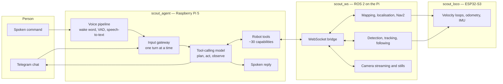

# Scout

**A home rover you talk to.** Scout is a tracked mobile robot that takes
instructions in plain language — typed or spoken — and carries them out with its
own wheels, camera, microphone array and speaker. "Hey Jarvis, go to the kitchen
and tell me if anyone's there" is one sentence to a person and, inside Scout, a
sequence of decisions made by a language model that plans, calls the robot's own
tools, looks at what its camera returned, and answers in the first person.

Scout runs entirely on the robot. A Raspberry Pi 5 hosts the conversational
agent, the voice pipeline, the ROS 2 stack, mapping and navigation; a Hailo-10H
neural accelerator runs object detection and speech recognition on-device; and an
ESP32-S3 closes the motor control loops. The language model is the only component
that may live off-board, and even that is a configuration choice — the same
system runs against a model served on the local network.

> **Status:** an actively developed personal robotics project, documented here
> for readers who want to understand how a conversational agent is safely wired
> to real hardware. This repository is documentation only; it contains no source
> code.

---

## Contents

| Guide | What it covers |
|---|---|
| **[1. System architecture](docs/01-architecture.md)** | How the three codebases and three runtimes fit together, and the design rules that hold across them |
| **[2. The agent — AI and agentic features](docs/02-ai-agent.md)** | The flagship layer: tool-calling agent, middleware, multimodal vision, memory, budgets, policy and grounding |
| **[3. Voice interaction](docs/03-voice.md)** | Wake word, endpointing, on-device and cloud speech recognition, spoken replies, follow-up turns, look-at-the-speaker |
| **[4. Perception and vision](docs/04-perception.md)** | NPU object detection and tracking, person following, the camera mount, and how the agent sees |
| **[5. Navigation and autonomy](docs/05-navigation.md)** | Mapping, localisation, Nav2, named rooms, multi-leg missions and remembered places |
| **[6. Robot platform](docs/06-platform.md)** | The ROS 2 workspace: nodes, interfaces, services, web control surfaces |
| **[7. Motion firmware](docs/07-firmware.md)** | The ESP32-S3 micro-ROS firmware: drive control, odometry, IMU, power, servos |
| **[8. Hardware](docs/08-hardware.md)** | Every physical component and what it contributes |
| **[9. Safety, reliability and limits](docs/09-safety-and-limits.md)** | The layered safety model and an honest account of what Scout cannot do |
| **[10. Technology stack and glossary](docs/10-technology.md)** | Every technology used, by layer, plus the terms this documentation uses |

New readers who care about the AI: start with
**[the agent](docs/02-ai-agent.md)**, then
**[voice](docs/03-voice.md)** and **[perception](docs/04-perception.md)**.
New readers who care about the robot: start with
**[architecture](docs/01-architecture.md)**.

---

## Feature highlights

### Conversational and agentic

- **Natural-language control of a physical robot.** A tool-calling language model
  drives roughly thirty robot capabilities — driving, room-to-room navigation,
  photography, camera aiming, person tracking, speech, volume, health and
  network reporting — and composes them into multi-step tasks it was never
  explicitly programmed for.
- **Two input surfaces, one agent.** Telegram chat and on-robot voice both hand
  plain text to a single gateway, so every capability is available by either
  route and both share one conversation and one robot.
- **It sees what it photographs.** Photographs taken during a task are fed back
  into the model as images for the rest of that task, so "go and look, then tell
  me what you saw" is answered from the picture rather than from a detector's
  label list.
- **Conversation memory that survives restarts.** Each chat is a durable
  checkpointed thread, so context outlives a process restart or a reboot.
- **Budgets and bounded turns.** Per-tool call caps and a bounded think-act round
  count stop a confused turn from driving a real machine around the house
  indefinitely — and end it with a sentence a person can hear, not a stack trace.
- **Policy the model does not get to reinterpret.** Camera tracking of people is
  opt-in, off at boot, and only ever started when a person asked for it; the
  rule is pinned by tests, including tests that run a real model against
  tempting prompts.
- **Grounded answers.** The agent reads the robot's clock, its live network
  state, its own health and its own map rather than answering from model priors,
  and reports "unknown" or "stale" instead of guessing.

### Voice

- **Wake word, on-device.** "Hey Jarvis" is detected locally, tuned on measured
  detection-score distributions rather than a default threshold.
- **Speech recognition on the robot's neural accelerator**, with an optional
  hosted high-accuracy path and automatic fallback between them.
- **Spoken replies** with streamed on-device synthesis and barge-in.
- **It answers questions it asked you.** When the agent needs a clarification it
  reopens the microphone straight after speaking — no second wake word, and one
  ask only.
- **It looks at whoever spoke.** The four-capsule microphone array's
  direction-of-arrival estimate turns the camera towards the talker and holds it
  there for the whole exchange.

### Perception and autonomy

- **Object detection and tracking on the Hailo-10H NPU**, concurrent with a
  lagless WebRTC camera view, sharing one accelerator with speech recognition.
- **Camera-only person tracking** and, separately, **person following** that
  drives the base — deliberately different features with different guarantees.
- **Room-level navigation.** Named, oriented areas mean "go to the kitchen"
  instead of coordinates, with multi-leg trips, remembered spots, and a rendered
  map the agent can send you.
- **Everything is a service you can start and stop** — from a phone, without a
  terminal.

---

## The three codebases

Scout is built as three independent repositories, split along runtime and
hardware boundaries rather than by feature.

| Repository | Runs on | Role |
|---|---|---|
| [`scout_agent`](https://github.com/Xmindz/scout_agent) | Raspberry Pi 5 (native Python process) | The conversational agent, its tools, and the whole voice pipeline. Talks to the robot only over a WebSocket bridge. |
| [`scout_ws`](https://github.com/Xmindz/scout_ws) | Raspberry Pi 5 (ROS 2 containers + native host helpers) | The robot platform: sensing, mapping, navigation, camera streaming, person tracking and following, web UI, process supervision. |
| [`scout_loco`](https://github.com/Xmindz/scout_loco) | ESP32-S3 microcontroller | Motion firmware: motor control, encoders, velocity loops, odometry, IMU, battery, camera-mount servos. |

The split is load-bearing. The agent cannot drive the robot directly — it asks —
and the firmware cannot be reasoned about by the model at all. Each boundary is
described in [System architecture](docs/01-architecture.md).

---

## How a request flows

---

## Technology at a glance

| Layer | Technology |
|---|---|
| Agent | LangGraph / LangChain agent runtime, OpenAI-compatible chat models (local or hosted), SQLite checkpointing |
| Voice | openWakeWord, Silero VAD, Whisper (on-device and hosted), Piper speech synthesis, four-microphone direction-of-arrival |
| Vision | Hailo-10H NPU, YOLO-family detection with persistent track IDs, GStreamer, WebRTC/WHEP streaming |
| Robotics | ROS 2 Jazzy, Nav2, slam_toolbox, robot_localization EKF, rosbridge, micro-ROS, TF2 |
| Firmware | ESP32-S3, Arduino/PlatformIO, micro-ROS over native USB, per-wheel PID, BNO055 sensor fusion |
| Operations | systemd unit-per-feature, containerised ROS 2, phone-friendly web control, Foxglove bridge |

Full detail, including what each choice was made instead of, is in
[Technology stack and glossary](docs/10-technology.md).

---

## Reading the rest of these docs

Each guide is written to stand alone and to be read in a browser on GitHub.
Diagrams are Mermaid and render inline. Interface names (topics, services, tool
names) are quoted so that readers cross-referencing the running system can find
them, but no source code appears anywhere in this repository.

Where a number is given — a latency, an accuracy figure, a range, a speed — it
is a measurement taken on the physical robot, not a specification copied from a
datasheet. Where Scout has a limit, [Safety, reliability and
limits](docs/09-safety-and-limits.md) states it plainly; that page is as much a
part of the design as the feature list.
