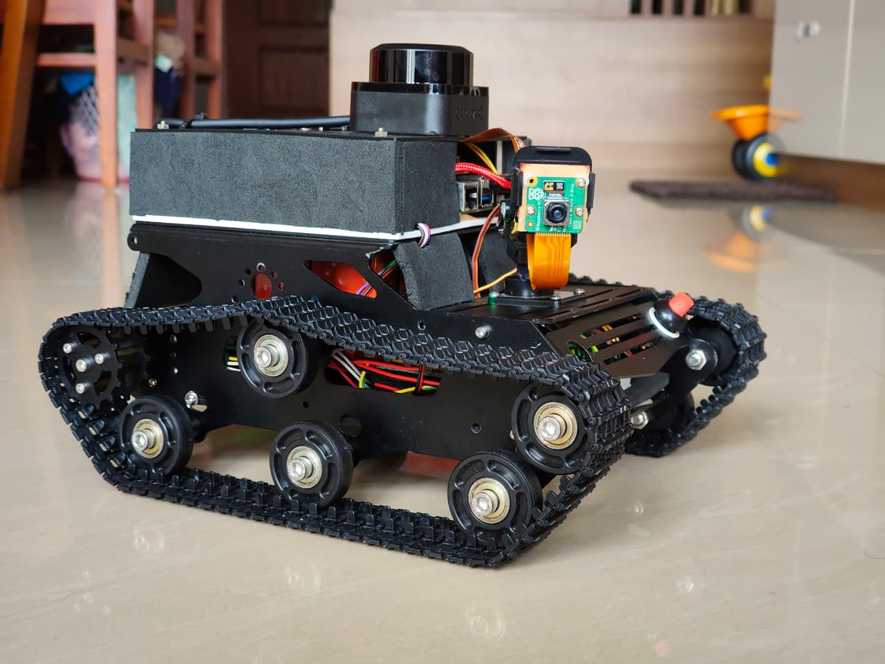
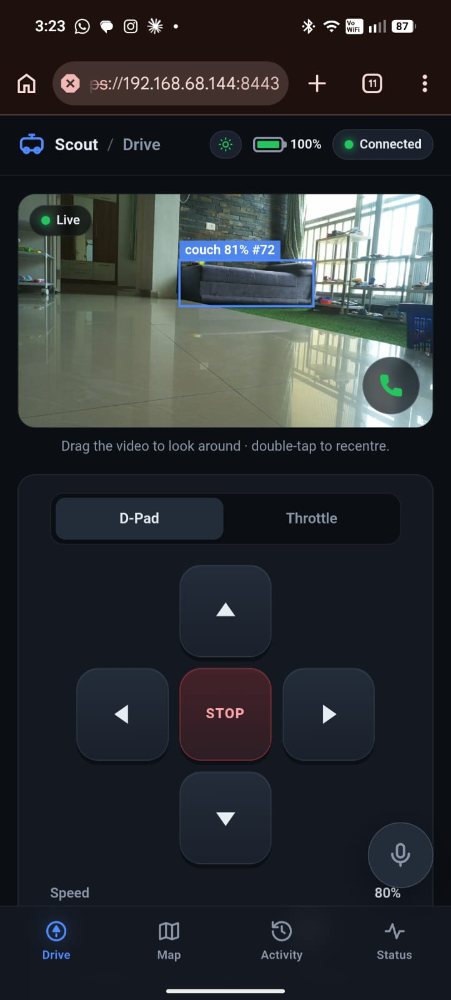
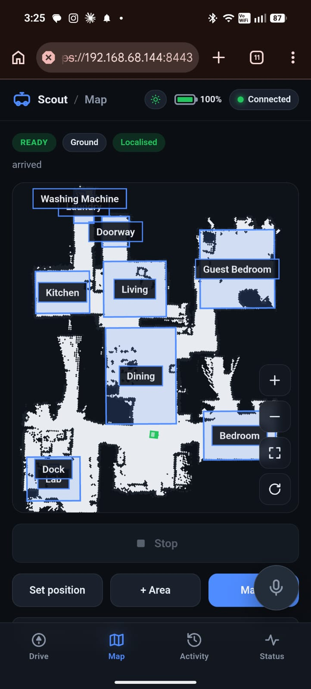
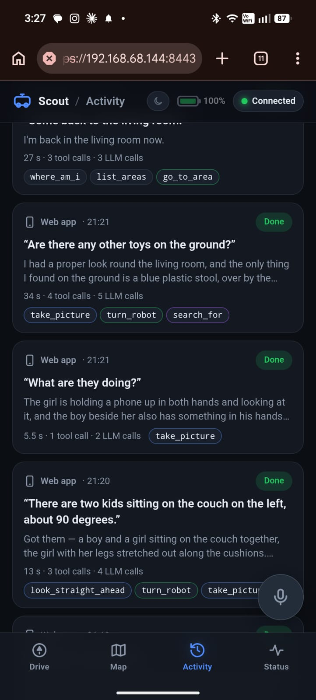
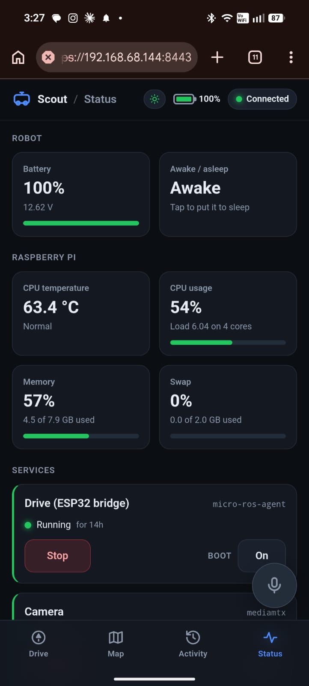
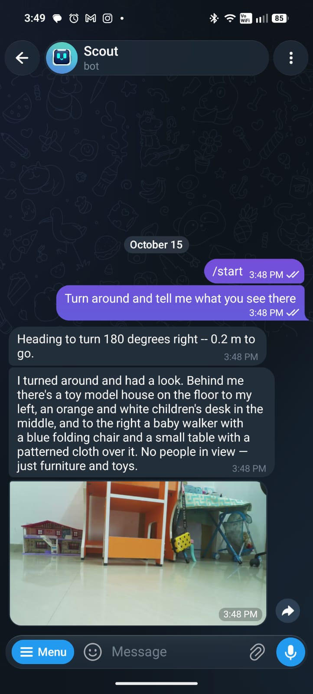
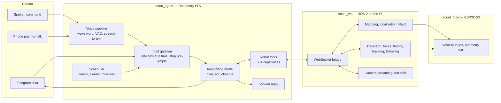

# Scout

  

**A home rover you talk to.** Scout is a tracked mobile robot that takes
instructions in plain language — typed, spoken to the robot, or spoken into a
phone — and carries them out with its own wheels, camera, microphone array and
speaker. "Hey Jarvis, go to the kitchen and tell me if anyone's there" is one
sentence to a person and, inside Scout, a sequence of decisions made by a
language model that plans, calls the robot's own tools, looks at what its camera
returned, and answers in the first person.

Scout runs on the robot. A Raspberry Pi 5 hosts the conversational agent, the
voice pipeline, the ROS 2 stack, mapping and navigation; a Hailo-10H neural
accelerator runs object detection, face recognition and open-vocabulary object
finding on-device; and an ESP32-S3 closes the motor control loops. The language
model and the speech recogniser are the only components that normally live
off-board, and both are configuration choices. The same system runs against a
model served on the local network, and against speech recognition on the robot's
own accelerator.

> **Status:** an actively developed personal robotics project, documented here
> for readers who want to understand how a conversational agent is safely wired
> to real hardware. This repository is documentation only; it contains no source
> code.

---

## Contents

| Guide | What it covers |
|---|---|
| **[1. System architecture](docs/01-architecture.md)** | How the three codebases and three runtimes fit together, and the design rules that hold across them |
| **[2. The agent — AI and agentic features](docs/02-ai-agent.md)** | The flagship layer: tool-calling agent, middleware, multimodal vision, search, faces, scheduling, sleep, home control, memory, budgets, interrupts, policy and grounding |
| **[3. Voice interaction](docs/03-voice.md)** | Wake word, endpointing, hosted and on-device speech recognition, English and Malayalam, spoken replies, follow-up turns, look-at-the-speaker, phone push-to-talk and live calls |
| **[4. Perception and vision](docs/04-perception.md)** | NPU object detection and tracking, face recognition, open-vocabulary finding, person following, the camera mount, and how the agent sees |
| **[5. Navigation and autonomy](docs/05-navigation.md)** | Mapping, localisation and self-relocalisation, Nav2, named rooms, multi-leg missions and remembered places |
| **[6. Robot platform](docs/06-platform.md)** | The ROS 2 workspace: nodes, interfaces, services, and the phone web app |
| **[7. Motion firmware](docs/07-firmware.md)** | The ESP32-S3 micro-ROS firmware: drive control, odometry, IMU, power, servos |
| **[8. Hardware](docs/08-hardware.md)** | Every physical component and what it contributes |
| **[9. Safety, reliability and limits](docs/09-safety-and-limits.md)** | The layered safety model and an honest account of what Scout cannot do |
| **[10. Technology stack and glossary](docs/10-technology.md)** | Every technology used, by layer, plus the terms this documentation uses |

New readers who care about the AI: start with
**[the agent](docs/02-ai-agent.md)**, then
**[voice](docs/03-voice.md)** and **[perception](docs/04-perception.md)**.
New readers who care about the robot: start with
**[architecture](docs/01-architecture.md)**.

---

## Scout in use

<table>
  <tr>
    <td align="center" width="25%"></td>
    <td align="center" width="25%"></td>
    <td align="center" width="25%"></td>
    <td align="center" width="25%"></td>
  </tr>
  <tr>
    <td align="center"><b>Drive</b> Live camera with detection boxes, drag-to-aim, D-pad or throttle, call button</td>
    <td align="center"><b>Map</b> Named rooms, localisation state, tap to navigate, the mapping workflow</td>
    <td align="center"><b>Activity</b> Every request, its reply and every tool call it took</td>
    <td align="center"><b>Status</b> Battery, sleep, Pi health, every service, reboot and shutdown</td>
  </tr>
</table>

<table>
  <tr>
    <td width="220"></td>
    <td>
      <b>The same agent over Telegram.</b> Asked to "turn around and tell me what
      you see there", Scout posts one progress line that updates as it turns.
      Then it describes the scene from the photograph it took (a toy house, a
      children's desk, a baby walker) and sends the photograph itself. The
      description comes from a vision-capable model looking at the picture, not
      from a detector's label list.
    </td>
  </tr>
</table>

The phone web app runs on the robot. A floating microphone button on every view
is push-to-talk to the agent, and the sun or moon pill in the header shows
whether the robot is awake or asleep. See [Robot platform](docs/06-platform.md#65-the-web-app).

---

## Feature highlights

### Conversational and agentic

- **Natural-language control of a physical robot.** A tool-calling language model
  drives more than fifty robot capabilities, composing them into multi-step tasks
  it was never explicitly programmed for. They cover driving, room-to-room
  navigation, searching, photography, face recognition, camera aiming, person
  tracking, speech, timers and alarms, sleep, home devices, health and network
  reporting.
- **Four ways in, one agent.** Telegram chat, on-robot voice, push-to-talk from a
  phone and the robot's own scheduled missions all hand plain text to a single
  gateway. So every capability is available by every route, and all of them
  share one robot.
- **It searches a room properly.** "Find a red water bottle in the kitchen" is one
  tool call. It picks viewpoints across the room, sweeps a full 360° at each one,
  keeps a coverage record that reports blind spots as gaps rather than "not
  there", and turns the body to face a find before it drives closer.
- **It knows people by face** once they have been introduced, on the robot's own
  accelerator, with nothing leaving the robot.
- **It sees what it photographs.** Photographs taken during a task are fed back
  into the model as images for the rest of that task, so "go and look, then tell
  me what you saw" is answered from the picture rather than from a detector's
  label list.
- **"Stop" means stop, even mid-mission.** A spoken or typed stop halts the wheels
  at once and ends the running turn at its next step, instead of queueing behind
  it.
- **It acts when nobody is there.** Timers, alarms and scheduled missions survive
  restarts and run through the same agent and the same safety budgets.
- **It sleeps.** After an hour of quiet, or when asked, it switches off its camera,
  scanner, detector and navigation. It still listens, talks and rings alarms, and
  wakes itself when a request needs its eyes.
- **It switches the lights.** Optional Home Assistant integration controls the
  devices the household has chosen to expose, and degrades to a sentence when
  the hub is out of reach.
- **Every turn is on the record.** An Activity log shows each request, every model
  call and tool call it made, how long they took, and the reply.
- **Budgets and bounded turns.** Per-tool call caps and a bounded think-act round
  count stop a confused turn from driving a real machine around the house
  indefinitely. When a turn hits a cap, it ends with a sentence a person can
  hear, not a stack trace.
- **Policy the model does not get to reinterpret.** Camera tracking of people is
  opt-in, off at boot, and only ever started when a person asked for it; the
  rule is pinned by tests, including tests that run a real model against
  tempting prompts.
- **Grounded answers.** The agent reads the robot's clock, its live network
  state, its own health and its own map rather than answering from model priors,
  and reports "unknown" or "stale" instead of guessing.

### Voice

- **Wake word, on-device.** "Hey Jarvis" is detected locally, with a threshold
  tuned on measured detection-score distributions rather than left at the
  default.
- **Accurate speech recognition** from a hosted Whisper model by default, with
  on-device recognition on the neural accelerator as a switchable alternative.
- **English and Malayalam.** One request switches the recogniser, the voice and
  the language the agent answers in, together, and the choice is remembered.
- **Spoken replies** with streamed on-device synthesis, a choice of voices, and
  barge-in.
- **It keeps listening after a question.** When a spoken reply ends in a question
  the microphone reopens straight away, with no second wake word, and one
  silence ends it.
- **It looks at whoever spoke.** The four-capsule microphone array's
  direction-of-arrival estimate turns the camera towards the talker and holds it
  there for the whole exchange.
- **Talk from your phone, or call the room.** Hold-to-talk on the web app runs a
  turn in the same conversation, and a call button gives a live two-way audio
  link through the robot's own microphone and speaker.

### Perception and autonomy

- **Object detection and tracking on the Hailo-10H NPU**, concurrent with a
  lagless WebRTC camera view, and sharing one decode of the camera stream with
  still photography.
- **Face recognition and open-vocabulary object finding** on the same
  accelerator, switched on only when something asks.
- **Camera-only person tracking** and, separately, **person following** that
  drives the base. These are deliberately different features with different
  guarantees.
- **Room-level navigation.** Named, oriented areas mean "go to the kitchen"
  instead of coordinates. Trips can have several legs, the robot remembers
  spots, and the agent can send you a rendered map.
- **It checks where it is before it drives**, by scoring its laser scan against
  the map, and finds itself again on the map when it has been picked up and
  moved.
- **Everything is a service you can start and stop** — from a phone, without a
  terminal.

---

## The three codebases

Scout is built as three independent repositories, split along runtime and
hardware boundaries rather than by feature.

| Repository | Runs on | Role |
|---|---|---|
| [`scout_agent`](https://github.com/Xmindz/scout_agent) | Raspberry Pi 5 (native Python process) | The conversational agent, its tools, the scheduler, sleep mode, the activity log and the whole voice pipeline. Talks to the robot only over a WebSocket bridge. |
| [`scout_ws`](https://github.com/Xmindz/scout_ws) | Raspberry Pi 5 (ROS 2 containers + native host helpers) | The robot platform: sensing, mapping, localisation, navigation, camera streaming, NPU vision services, person tracking and following, the web app, process supervision. |
| [`scout_loco`](https://github.com/Xmindz/scout_loco) | ESP32-S3 microcontroller | Motion firmware: motor control, encoders, velocity loops, odometry, IMU, battery, camera-mount servos. |

The split is load-bearing. The agent cannot drive the robot directly — it asks —
and the firmware cannot be reasoned about by the model at all. Each boundary is
described in [System architecture](docs/01-architecture.md).

---

## How a request flows

---

## Technology at a glance

| Layer | Technology |
|---|---|
| Agent | LangGraph / LangChain agent runtime, OpenAI-compatible chat models (local or hosted), SQLite checkpointing, LangGraph Studio for live inspection |
| Voice | openWakeWord, Silero VAD, Whisper (hosted, or on-device on the NPU), Sarvam for Malayalam, Piper speech synthesis, four-microphone direction-of-arrival, WebRTC for live calls |
| Vision | Hailo-10H NPU, YOLO-family detection with persistent track IDs, SCRFD + ArcFace face recognition, YOLO-World + CLIP open-vocabulary finding, GStreamer, WebRTC/WHEP streaming |
| Robotics | ROS 2 Jazzy, Nav2, slam_toolbox, scan-to-map localisation checks, robot_localization EKF, rosbridge, micro-ROS, TF2 |
| Firmware | ESP32-S3, Arduino/PlatformIO, micro-ROS over native USB, per-wheel PID, BNO055 sensor fusion |
| Operations | systemd unit-per-feature, containerised ROS 2, a single-page phone web app, Home Assistant (optional), Foxglove bridge |

Full detail, including what each choice was made instead of, is in
[Technology stack and glossary](docs/10-technology.md).

---

## Reading the rest of these docs

Each guide is written to stand alone and to be read in a browser on GitHub.
Diagrams are Mermaid and render inline. Interface names (topics, services, tool
names) are quoted so that readers cross-referencing the running system can find
them, but no source code appears anywhere in this repository.

Where a number is given — a latency, an accuracy figure, a range, a speed — it
is a measurement taken on the physical robot, not a specification copied from a
datasheet. Where Scout has a limit, [Safety, reliability and
limits](docs/09-safety-and-limits.md) states it plainly; that page is as much a
part of the design as the feature list.
