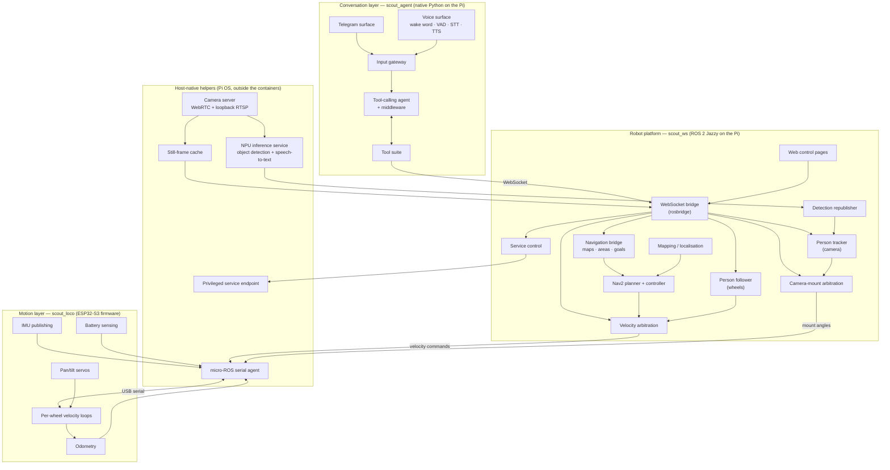
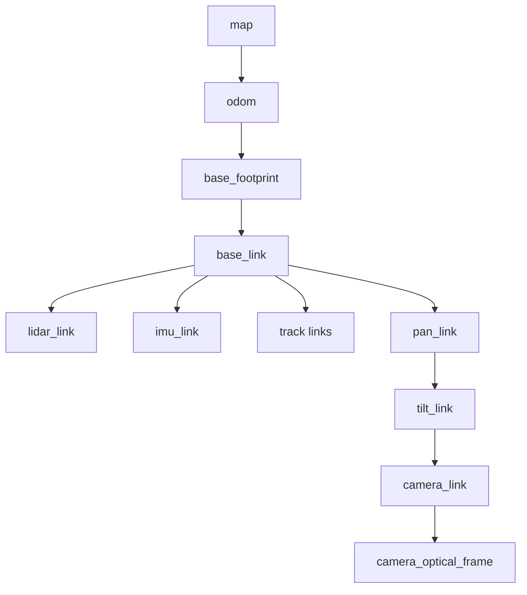

# 1. System architecture

[← Back to index](../README.md)

Scout is one robot built from three codebases and running across three runtimes:
a native Python process on the Raspberry Pi host, a set of containerised ROS 2
processes on the same Pi, and firmware on an ESP32-S3 microcontroller. The
boundaries between them are deliberate, and most of them exist because of a
constraint that was measured rather than assumed.

---

## 1.1 The three layers

**Conversation layer ([`scout_agent`](https://github.com/Xmindz/scout_agent)).**
Everything to do with understanding a person and deciding what to do. It holds
the language model, the tool definitions, the conversation memory and the entire
voice pipeline. It speaks to the robot only through a WebSocket bridge, using the
same public interfaces the web UI uses — no privileged access, no ROS
installation of its own.

**Robot platform ([`scout_ws`](https://github.com/Xmindz/scout_ws)).**
Everything to do with sensing, estimating, mapping, planning and arbitrating.
This layer owns the robot's physical truth: where it is, what it can see, which
input is allowed to drive right now, and which of its own subsystems are
running.

**Motion layer ([`scout_loco`](https://github.com/Xmindz/scout_loco)).**
Everything that has to happen on a deadline: pulse-width modulation, encoder
interrupts, velocity loops, the failsafe that stops the tracks when commands stop
arriving. It publishes measurements and consumes commands, and it makes no
decisions about where the robot should go.

---

## 1.2 Why the agent is not allowed to drive

The single most important structural rule in Scout is that the conversation layer
asks and the robot platform acts.

Concretely: when a person says "follow me", the agent makes two service calls —
start tracking with the camera, then start following with the wheels — and then
stops touching the robot. The control loop that actually drives after the person
runs on the robot, ten times a second, next to the laser scanner it is avoiding
obstacles with. The agent process does not, and cannot, publish velocity
commands for that feature. That property is enforced by a test that inspects the
tracking module's syntax tree and fails if it so much as names a velocity topic.

The same separation appears throughout:

| Decision | Where it lives | Why not in the agent |
|---|---|---|
| Which person is being followed, when the lock is lost, when to re-acquire | Robot platform (tracker) | Needs every detection frame, at frame rate |
| How far back to sit, when to turn, when to stop for an obstacle | Robot platform (follower) | Needs the laser scan in the same loop as the wheels |
| Which room the robot is standing in | Robot platform (navigation bridge) | The geometry already lives there; two copies would drift |
| Whether a velocity command is allowed through right now | Robot platform (velocity arbitration) | Must hold even if the agent crashes |
| What the person actually wants, and in what order | Conversation layer | The only place with the conversation |

The agent's job is intent, sequencing, explanation and honesty. Everything with a
deadline or a physical consequence sits below it.

---

## 1.3 Runtime boundaries and the constraints behind them

Several parts of Scout run natively on the Raspberry Pi OS host rather than
inside the ROS 2 containers, and each case has a specific cause:

- **The camera is opened exactly once.** The Pi 5's camera stack does not support
  a second concurrent open, so one native camera server owns the device. The live
  WebRTC view, the still-frame service the agent photographs through, and the
  object-detection pipeline all draw from that single already-open stream over a
  loopback-only mux. Nothing else touches the camera.
- **Neural-accelerator work runs on the host.** The NPU runtime's userspace
  driver has to match the kernel module bound to the device, which is cleanest
  against the host's own installation.
- **One process owns the accelerator.** The accelerator is handed out as a single
  virtual device, and a second process asking for it is refused. Object
  detection and speech-to-text therefore run *inside the same host process* and
  time-share the device through the runtime's round-robin scheduler — the
  detail that makes on-device speech recognition possible at all. See
  [Voice interaction](03-voice.md) and [Perception](04-perception.md).
- **Privileged operations go the long way round.** A browser cannot manage system
  services, and neither can a containerised process. So the chain runs browser →
  WebSocket bridge → a ROS node → a loopback HTTP endpoint on the host → an
  exact-string allowlist → the service manager. Nothing new is exposed to the
  network, and the privileged side accepts only known unit names and actions.
- **Cross-container messaging is forced onto UDP.** The default ROS 2 middleware
  prefers shared memory between same-host participants, but separate containers
  do not share it. Discovery still succeeds while traffic silently disappears —
  a failure that looks like a hung service call rather than a transport problem.
  Every container pins the transport explicitly.

---

## 1.4 One feature, one service

Every capability on the robot is its own supervised system service: robot core
and transforms, laser scanner, detection republisher, mapping, navigation,
observability bridge, and the web/bridge stack. They start and stop
independently.

This has three consequences worth naming:

1. **A scanner hiccup no longer costs the transform tree.** Sensors used to share
   a launch file with the things that depend on them; now a restart is scoped.
2. **The robot can be reconfigured from a phone.** A Services page lists every
   unit with independent run-now and start-at-boot controls, dependency warnings,
   and type-to-confirm on the dangerous ones — because "stop the laser scanner"
   is a single service action.
3. **The agent can bring up what it needs.** When a person asks for a
   navigation goal and navigation is not running, the agent starts it, waits, and
   says that it is waiting. Some units are explicitly protected from the agent:
   the serial bridge to the microcontroller (opening its port resets the board
   and drops motor state mid-motion) and the web/bridge stack (which hosts the
   very connection the agent is talking over).

Mapping and navigating are also mutually exclusive, enforced by the service
manager rather than by convention: both would publish the same map-to-odometry
transform, and two disagreeing estimates flipping many times a second reads like
a localisation bug rather than a configuration mistake.

---

## 1.5 Arbitration: who gets the robot

Two physical resources have multiple would-be owners, and each has an explicit
arbiter.

**The wheels.** Browser teleoperation, autonomous navigation and the person
follower all want to drive. A velocity multiplexer relays whichever input is
live, with teleoperation at the top: grabbing the on-screen controls overrides an
autonomous goal on the next tick, and the navigation bridge then cancels that
goal so it does not resume when you let go. The multiplexer zeroes its output
roughly four tenths of a second after every input goes quiet — a closed tab, a
locked phone, a dropped network — so the robot does not continue on a stale
command. Nothing else is permitted to publish the final velocity topic.

**The camera mount.** Operator teleoperation, the agent, and the person tracker
all want to aim it. A mount multiplexer resolves them in that priority order,
publishes on change rather than on a clock, and treats *idle as hold* — the
camera stays where it was last put rather than recentring. The agent's priority
window is time-bounded, which the agent's own tools account for: aiming the
camera during a follow is permitted, and every reply says that the tracker is
about to take the camera back.

---

## 1.6 Estimation and transforms

One publisher owns each transform edge, and the ownership is documented because
duplicate publishers produce pose jitter that is extremely hard to trace.

- The firmware publishes wheel odometry as a **message only** and deliberately
  broadcasts no transform.
- An extended Kalman filter fuses that wheel odometry with the IMU and is the
  sole owner of the odometry-to-robot edge.
- The mapping/localisation subsystem owns the map edge, and exists only while
  mapping or navigation is running.
- Everything below the robot base is derived from the robot's geometric model,
  and is static except the two camera-mount joints. Those are modelled from the
  commanded angles, because the hobby servos have no position feedback — so the
  camera frame is where the camera was *told* to point, a distinction the tracker
  and the agent's aiming tools both have to respect.

---

## 1.7 Coordinate honesty: three angle systems

The camera mount is not mounted straight, and the firmware's servo angles are not
the camera's angles. The horns are keyed several degrees off in both axes, the
firmware maps the tilt range onto the servo's full write range (so tilt is scaled
and inverted), and the servos cover less travel than their nominal range
suggests, scaling both axes.

Rather than spread those corrections around, a single calibration module is the
only place the two systems meet: **true camera angles everywhere on the robot,
firmware angles on the final mount command alone.** The same module holds the
measured mechanical stops, which are what actually protect the servos — the
firmware's own clamps sit outside the mount's real travel in every direction.

This is a small thing that illustrates a general rule in Scout: when a number
exists in two places it eventually disagrees with itself, so calibration
constants live once and are shared, including across the agent/platform
boundary where the agent needs to know the mount's reach.

---

## 1.8 What the agent is given, and what it is told

The interface the agent sees is deliberately shaped for a language model, not
for a programmer:

- **Names, not coordinates.** Rooms are named areas; "which room am I in" is a
  question the robot answers, not geometry the agent recomputes.
- **Plain-English results.** Tool results explain what happened, including what
  the robot is *about to* do (a mount handing control back, a camera returning to
  centre, a trip that stopped early), so the model narrates reality instead of
  its assumptions.
- **Distinct facts get distinct words.** "The person walked out of shot" and "the
  detection pipeline has gone silent" are different failures with different
  fixes, and are never collapsed into one message.
- **Unknown is a valid answer.** Health, network, map validity and tracking state
  all report unknown or stale rather than defaulting to fine.

Those choices are described in detail in [The agent](02-ai-agent.md).

---

| ← Previous | Next → |
|---|---|
| [Index](../README.md) | [2. The agent — AI and agentic features](02-ai-agent.md) |
