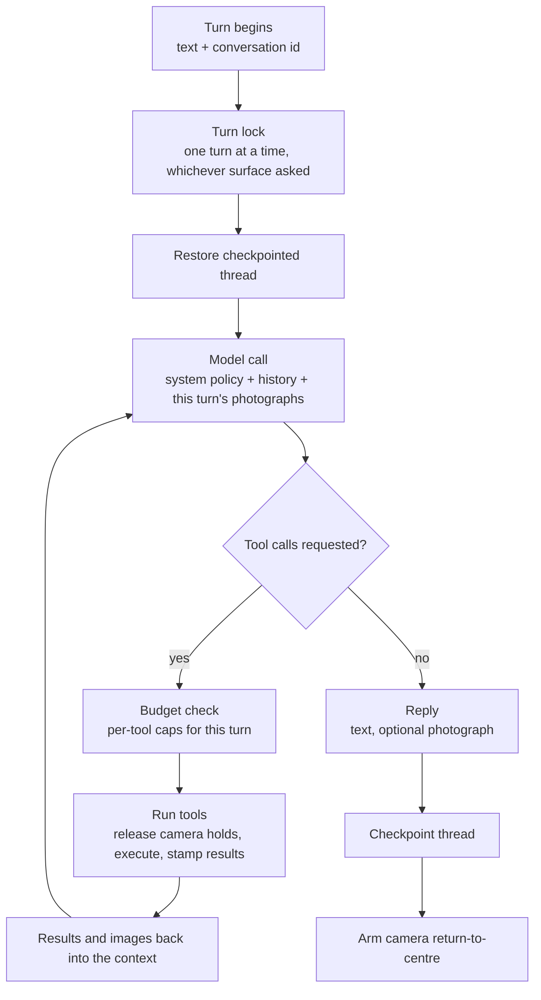
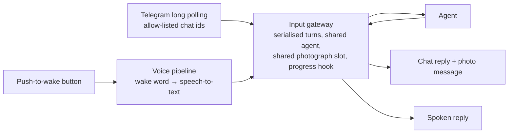
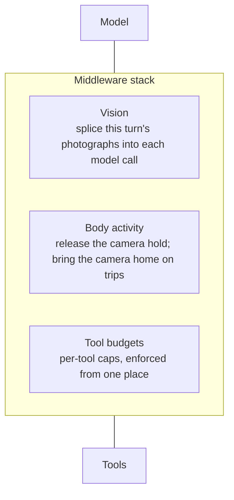

# 2. The agent — AI and agentic features

[← Back to index](../README.md) · [← 1. Architecture](01-architecture.md)

This is the layer that makes Scout a robot you talk to rather than a robot you
operate. A tool-calling language model receives what a person said, plans a
sequence of actions, calls the robot's own capabilities, observes what came
back — including photographs, as images — and answers in the robot's own voice.

Everything in this guide runs in a single process on the robot.

---

## 2.1 The agent loop

Scout uses a **ReAct-style agent**: the model reasons, calls tools, reads the
results, and repeats until it has an answer. The loop is built on the
**LangGraph / LangChain** agent runtime, with a middleware stack wrapped around
both the model call and every tool call.

**Model independence.** The agent talks to any OpenAI-compatible chat endpoint,
selected by configuration: a model served on the local network, or a hosted
provider. The only hard requirement is reliable tool calling; photograph
understanding additionally wants a vision-capable model. Swapping provider is
three settings and no code change, which is what makes it practical to trade
latency, cost, privacy and capability on the same robot.

**Bounded turns.** A single turn may take up to **24 think-act rounds** — one
model call plus the tools it asked for. That figure is chosen from real tasks:
"go to the living room, check for people, come back and report" is about a dozen
rounds once the look-then-decide cycle is taken seriously, and a patrol with a
photograph at each stop is more. The underlying graph-step limit is *derived*
from that number rather than written down separately, and a test measures the
real middleware stack against it, so adding middleware cannot silently shrink
how much work a turn is allowed to do.

---

## 2.2 Two input surfaces, one agent

Telegram and voice are both **text producers**. Neither talks to the agent graph
directly; both hand `(text, conversation id)` to a single input gateway that
returns `(reply, optional photograph)`.

This is why adding speech required no changes to the agent, the tools or the
graph — and why every capability is available from either surface.

Three details make the shared surface correct rather than merely convenient:

- **Turns are serialised on a lock.** The agent, the robot connection, the
  photograph slot and the progress hook are process-wide. One process means one
  agent and one place that decides which input gets the robot next.
- **A photograph goes back to the turn that took it.** The photograph slot is
  shared, so the gateway binds each image to its originating turn — a covered
  case with its own test, and the kind of bug that only appears once there are
  two input surfaces.
- **One process, on purpose.** Running voice as a second service would buy crash
  isolation at the cost of a second copy of the speech models, a second HTTP
  surface, and — more seriously — a second agent with its own conversation
  history driving the same hardware.

---

## 2.3 The tool suite

Roughly thirty tools, grouped by what they touch. Every one returns plain
English, and several return facts the model is explicitly told it cannot infer.

### Driving and navigation

| Tool | What it does |
|---|---|
| `move_robot` | Drive a measured distance forward or back (5 cm to 3 m). Runs as a navigation behaviour, so it is measured on odometry and **stops short of obstacles** on the local costmap rather than driving into them. |
| `turn_robot` | Turn a measured angle (5° to 360°), same mechanism. |
| `stop_robot` | Cancel any active goal, zero the velocity, and stop any follow. Never gated behind a confirmation. |
| `go_to_area` | Navigate to a named room. |
| `run_patrol` | Visit several named rooms in order, optionally returning to where the trip started. |
| `get_navigation_state` | Current mode, pose validity, goal state. |
| `list_areas` | The real names of the rooms this robot knows. |
| `where_am_i` | Which named area the robot is standing in — answered by the robot, not recomputed. |

### Places and maps

| Tool | What it does |
|---|---|
| `name_this_place` | Record a permanent named area on the map. |
| `remember_this_spot` | Remember the current pose under a label for this session. |
| `go_back` | Return to a labelled spot, or to wherever the last trip started. |
| `distance_and_direction` | Straight-line distance and a **body-relative** direction ("ahead and to my left") to an area or remembered spot, plus the turn that faces it. Never a compass point, because the map's axes are arbitrary. |
| `show_map` | Render the live map with rooms, the robot and remembered spots drawn on it, levelled to the building's own walls, and send it as a picture. |

### Seeing

| Tool | What it does |
|---|---|
| `what_do_you_see` | The current object detections from the neural accelerator. |
| `take_picture` | Capture a still through the camera; the person receives the actual photograph, and **the model is shown it too**. |

### Aiming the camera

| Tool | What it does |
|---|---|
| `look_toward` | Point the camera at a direction measured from straight ahead. |
| `look_further` | Nudge on from where the camera already points ("a bit more to the left"). |
| `look_straight_ahead` | Recentre both axes. |
| `get_camera_direction` | Where the camera is currently looking. |

### Watching and following people

| Tool | Camera | Wheels |
|---|---|---|
| `track_me` | Follows the person | Robot stays put |
| `follow_me` | Follows the person | Robot turns and drives after them |
| `stop_following` | Stops **both**, from any state | — |
| `get_tracking_state` | Reports honestly, including "still looking, nobody found" | — |

### Talking, listening and the robot itself

| Tool | What it does |
|---|---|
| `make_announcement` | Read a message out of the robot's speaker — typed from another room and spoken where the robot is. Blocks until the speaker has finished, and reports failure as a failed call rather than a log line. |
| `listen_for_reply` | Reopen the microphone right after speaking, so the person can answer a question the robot asked. |
| `get_volume` / `set_volume` / `increase_volume` / `decrease_volume` | Loudness, with a short confirmation tone at the new level. |
| `get_robot_health` | Processor temperature, load, memory, disk, battery, and which subsystems are actually running — each reported as unknown or stale rather than assumed fine. |
| `get_current_date` | The robot's own date, time and timezone. |
| `get_network_info` | Which network the robot is on and its reachable address. |

Four of these never touch the robot platform at all: the clock and the network
are the host's own, and speech and volume are the microphone array this process
already owns.

---

## 2.4 Grounding: refusing to answer from priors

A language model on a robot has a specific failure mode — answering a question
about the physical present from training data. Scout closes the obvious holes
deliberately:

- **Time.** The model has no clock. Left to guess, it answers from whenever its
  training data stopped, which quietly poisons "remind me this evening", "did
  anything come past today" and every duration a person asks about. The policy
  tells it to read the robot's clock before answering anything that depends on
  when *now* is.
- **Network.** "What Wi-Fi are you on" and "what's your IP" are answered from the
  live routing table, and specifically from the interface carrying the default
  route. A container's internal address is a real address that nothing outside
  the robot can reach; handing it to somebody trying to connect sends them off
  debugging their router.
- **Position.** Rooms come from the robot's own containment test. Directions are
  body-relative. A remembered spot is tied to the map it was recorded on and is
  refused on any other.
- **Health.** Three independent sources — host telemetry, which services are
  running, battery state — are combined into one plain-English answer, with
  staleness surfaced per source.
- **Its own actions.** The policy states that the agent may never claim to have
  moved, stopped, checked or photographed anything unless it actually called the
  corresponding tool.

---

## 2.5 Vision in the loop: the model sees its own photographs

Tool results are text. The interesting robot observation is an image. Scout
bridges that gap in middleware.

When a picture tool runs, its result is stamped with the file it produced. Right
before each model call, every photograph taken **during the current turn** is
spliced into the messages as image content the model can actually look at.
Nothing image-shaped is written to the conversation checkpoint; the splice
applies to that one call.

Two earlier versions of this were wrong in ways worth recording, because both
were found on a real "inspect the dining room and report back" task:

1. **Only the last message was examined.** The model had asked for a photograph
   and a detection list together, the detection list came back last, and the
   photograph was never shown at all.
2. **Each photograph was shown for exactly one model call.** That call was spent
   aiming the camera for the next shot, so by the time the model wrote its report
   every photograph was gone — and it reported the detector's labels and pointed
   the person at the image files instead of describing them.

Now each photograph persists for the whole turn, captioned when it is shown
again, with a cap of **eight images per model call** (newest kept) so a patrol
that photographs every stop does not resend the whole album on every step.

---

## 2.6 Middleware: the policies that wrap every call

The agent's behaviour is shaped by three middleware layers rather than by prompt
text alone. Prompt text is advice; middleware is enforcement.

**Vision middleware** — described above.

**Body-activity middleware** — resolves a conflict between two things that both
want the camera. While a person is being answered by voice, a hold keeps the
camera on them (see [Voice](03-voice.md)). If the agent then aims the camera,
photographs something, or drives, that hold must let go first — otherwise an aim
is overwritten a quarter of a second later and a photograph is of wherever the
talker happens to be rather than what was asked for. Membership of the affected
set is about **the body, not importance**: reading the camera direction or the
tracking state does not release the hold; speaking does not either, because
speaking is what the hold is for; and photographing *does*, even though it moves
nothing, because a camera re-aimed mid-shutter is the same problem by another
route. Tools that drive the robot somewhere else additionally bring the camera
back to centre before setting off — an "inspect the dining room and come back"
mission once drove the whole way home looking forty degrees to the right.

**Tool-budget middleware** — per-tool caps on a single turn, enforced in one
place, because every capped tool costs the person something a retry cannot give
back:

| Capped tool | Cap per turn | Why |
|---|---|---|
| `move_robot`, `turn_robot` | 12 each | Real motion, real batteries |
| `go_to_area`, `go_back` | 6 each | Minutes of a machine driving around a house |
| `run_patrol` | 3 | Multi-leg trips, multiplied |
| `track_me`, `follow_me` | 2 each | A second start silently re-locks onto whoever is nearest *now* — never a fix for a tracking problem |
| `make_announcement` | 3 | Holds the speaker for as long as the sentence takes, and cannot be talked over |
| `listen_for_reply` | 2 | One turn produces one reply; asking twice cannot open the microphone twice |

Read-only tools and cheap, self-correcting ones are deliberately **not** capped:
capping those buys nothing and takes away the look-then-decide cycle the policy
asks for.

When a budget runs out, the turn ends on a sentence written to be *heard*, since
replies are spoken aloud — not on a framework message about a call-limit
counter.

---

## 2.7 Memory and persistence

- **Durable conversation threads.** Each conversation is checkpointed to a local
  SQLite database, keyed by chat. A follow-up that references earlier context
  still works after the agent process has been restarted — a documented
  acceptance check, not an implementation detail.
- **Turn-scoped state stays out of the checkpoint.** Per-turn tool counts and
  spliced images are deliberately not persisted; they describe one turn, not the
  conversation.
- **Session places.** Remembered spots live in memory for the session; naming a
  place permanently is a separate, explicit tool that writes to the robot's map.
- **Departure points.** The pose before the last trip is snapshotted so "go back"
  means the room the robot came from. Small nudges and "go back" itself do not
  overwrite it.

---

## 2.8 Policy the model does not get to reinterpret

Pointing a camera at people is the one feature where a helpful model is a
liability. Scout's rule: **tracking is opt-in, off at boot, and only ever started
because a person asked for it** — never because somebody turned up in a detection
list, and never as a helpful extra on some other task.

That rule is enforced in three independent places:

1. **The robot** refuses to drive after anyone unless the camera is already
   tracking a locked target, and re-checks on every control tick.
2. **The agent** carries the rule in its system policy *and* in each tool's own
   description, and the exact wording is pinned by tests — so a future edit that
   weakens it fails the suite.
3. **A live-model test**, opt-in, runs a real model against tempting prompts such
   as "there's someone in the kitchen" and asserts that no tracking start was
   issued. That is the one rule only the model can break, so it is tested against
   a model rather than a mock.

Starting a follow is **two calls, camera first**, and if the wheels refuse, the
camera tracking is stopped again rather than left running on its own — a
swivelling camera is not a smaller version of being followed, it is a thing
nobody asked for.

---

## 2.9 Long tasks: progress instead of silence

A navigation goal can take minutes. Scout treats silence as a bug:

- The mission runner dispatches a goal, polls robot status about twice a second
  until the robot reports a terminal state, and emits a progress line every few
  seconds.
- The chat surface posts one message and **edits it in place**, so a two-minute
  drive shows a live distance-to-go instead of two minutes of nothing.
- A leg that exceeds its timeout is **cancelled**, not abandoned — the alternative
  is a timed-out call and a robot still driving.
- A multi-leg trip **stops at the first leg that does not succeed**, because after
  a failed leg the robot is not where the rest of the trip assumed it would be.

The agent will also start the navigation subsystem itself when a goal needs it,
wait, and say that it is waiting. It will not send a goal when the robot does not
know where it is, or on a map that is drawable but not navigable, and it says
which of those it is.

---

## 2.10 Tone, embodiment and honesty

The system policy is a design artefact in its own right. Three themes run
through it:

**Speak as the body.** Scout is told it *is* the robot, not an assistant standing
next to one: "I'll drive to the kitchen", "I'm not in a named area", "I can't see
anyone from here". Hardware messages worded in the third person get re-spoken in
the first.

**State limits once, then get on with it.** Scout cannot keep up with a walking
adult; the camera trails a fast mover; the mount cannot look behind; the laser
scanner sees one thin slice. The policy carries these so the model states them
plainly rather than apologising repeatedly or blaming the wrong subsystem.

**Distinguish facts that fail differently.** Somebody walked out of shot is not
the same as the detection pipeline having gone silent. A mount still travelling
back to centre is not idle. A map read off disk is not a map the robot is
localised in. Each of those pairs gets different words, because collapsing them
sends the person after the wrong problem.

---

## 2.11 Testing an agent that drives a real machine

Scout's agent is tested without a robot, at a protocol boundary:

- **The robot is faked at one seam** — the same interface a native ROS backend
  would implement — so tools, missions and status parsing are all exercised
  against a fake robot.
- **Virtual time** means a three-minute leg timeout is tested instantly, including
  that the timeout cancels the goal.
- **Failure paths are first-class tests**: an invalid pose, a missing distance
  reading, a subsystem that has never reported, a cold-start blind detection
  pipeline, a refused start surfacing as a result rather than an exception.
- **Static guards** walk module syntax trees and fail if the tracking and aiming
  code so much as names a velocity topic — the agent process is structurally
  unable to drive the robot, even for the feature whose entire point is driving.
- **Policy tests** pin the wording that carries the consent rules.
- **A structural test** measures the real middleware stack's cost per think-act
  round, so a stale constant fails a test rather than a mission.

---

| ← Previous | Next → |
|---|---|
| [1. System architecture](01-architecture.md) | [3. Voice interaction](03-voice.md) |
