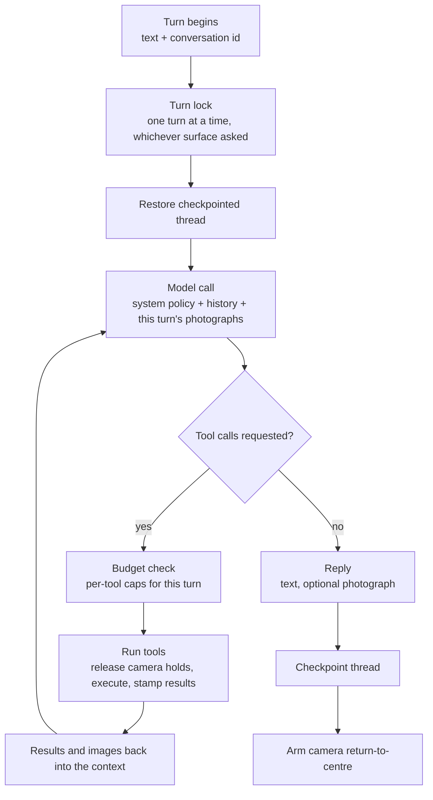
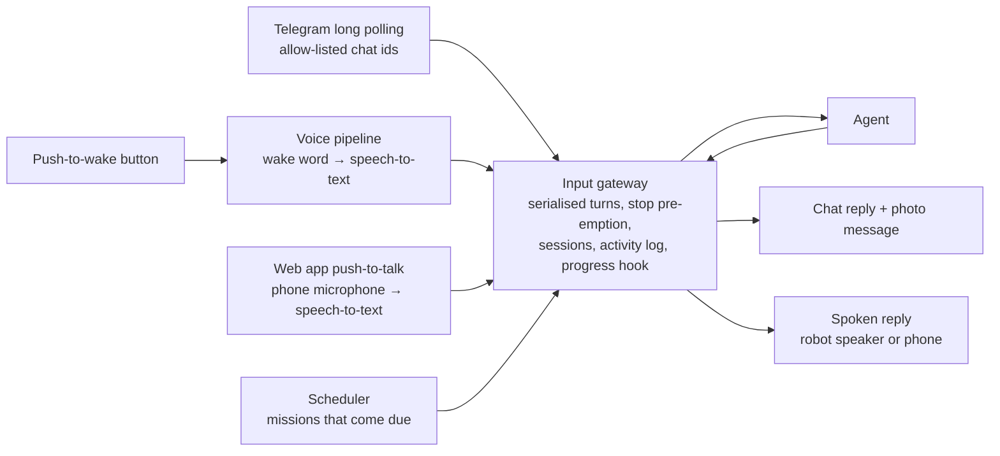
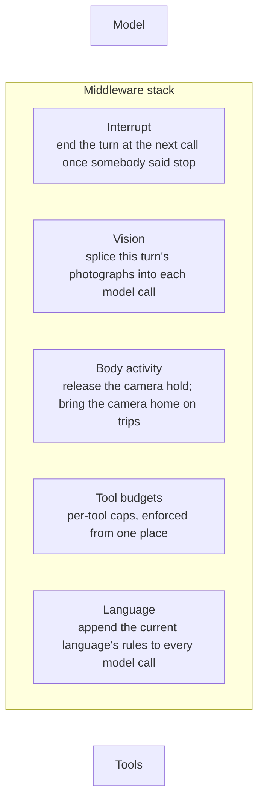
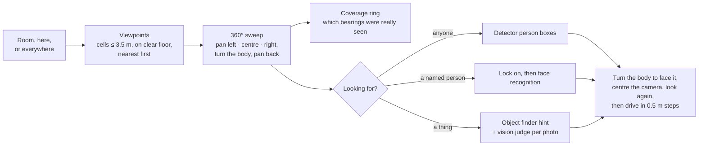

# 2. The agent — AI and agentic features

[← Back to index](../README.md) · [← 1. Architecture](01-architecture.md)

This is the layer that makes Scout a robot you talk to rather than a robot you
operate. A tool-calling language model receives what a person said, plans a
sequence of actions, calls the robot's own capabilities, observes what came
back — including photographs, as images — and answers in the robot's own voice.

Everything in this guide runs in a single process on the robot.

---

## 2.1 The agent loop

Scout uses a **ReAct-style agent**: the model reasons, calls tools, reads the
results, and repeats until it has an answer. The loop is built on the
**LangGraph / LangChain** agent runtime, with a middleware stack wrapped around
both the model call and every tool call.

**Model independence.** The agent talks to any OpenAI-compatible chat endpoint,
selected by configuration: a model served on the local network, or a hosted
provider. The only hard requirement is reliable tool calling; photograph
understanding additionally wants a vision-capable model. Swapping provider is
three settings and no code change, which is what makes it practical to trade
latency, cost, privacy and capability on the same robot. The robot currently
runs against a hosted DeepSeek model.

**A second model call for judging photographs.** A room search takes far more
photographs than one turn can carry, and what it needs back is a position in a
photograph rather than a sentence. So search photographs go to a separate
*vision judge*, which can be a different model from the conversational one (see
[§2.11](#211-searching-for-people-and-things)). Extended reasoning is switched
off for the judge where the provider supports that. Measured on the robot, one
ambiguous photograph took around 30 s with reasoning on and about 1.1 s with it
off, for the same verdict, and a sweep waits for its slowest photograph.

**Bounded turns.** A single turn may take up to **24 think-act rounds** — one
model call plus the tools it asked for. That figure is chosen from real tasks:
"go to the living room, check for people, come back and report" is about a dozen
rounds once the look-then-decide cycle is taken seriously, and a patrol with a
photograph at each stop is more. The underlying graph-step limit is *derived*
from that number rather than written down separately, and a test measures the
real middleware stack against it, so adding middleware cannot silently shrink
how much work a turn is allowed to do.

---

## 2.2 Four input surfaces, one agent

Telegram, on-robot voice, push-to-talk from the web app and the robot's own
scheduler are all **text producers**. None of them talks to the agent graph
directly; each hands `(text, conversation id)` to a single input gateway that
returns `(reply, optional photograph)`.

This is why adding speech, the phone and scheduled missions required no changes
to the agent, the tools or the graph — and why every capability is available
from every surface. Each turn is prefixed with a short note saying where it
came from, so the model knows, for example, that a phone user may not be
standing next to the robot, or that nobody typed a scheduled mission.

  
   
  A Telegram turn: one progress line that updates while the robot turns, then a reply written from the photograph it took, with the photograph attached.

Five details make the shared surface correct rather than merely convenient:

- **Turns are serialised on a lock.** The agent, the robot connection, the
  photograph slot and the progress hook are process-wide. One process means one
  agent and one place that decides which input gets the robot next.
- **A photograph goes back to the turn that took it.** The photograph slot is
  shared, so the gateway binds each image to its originating turn — a covered
  case with its own test, and the kind of bug that only appears once there is
  more than one input surface.
- **One process, on purpose.** Running voice as a second service would buy crash
  isolation at the cost of a second copy of the speech models, a second HTTP
  surface, and — more seriously — a second agent with its own conversation
  history driving the same hardware.
- **"Stop" does not wait its turn.** Because turns are serialised, a "stop" used
  to queue behind the very mission it was meant to end. Now every surface checks
  whether a message is *only* a stop ("stop", "cancel", "never mind", and the
  Malayalam forms) before taking the lock. If it is, the gateway halts the wheels,
  cancels any navigation goal and any follow straight away from the caller's
  thread, and then raises a flag. The running turn notices that flag at its next
  model call, its next tool call, or inside any wait a mission or search is
  sleeping through, and unwinds. The wheels are stopped again once the turn has
  unwound, in case it set off again in between. Telegram also has a `/stop`
  command.
- **Conversations end on their own.** Spoken commands share one conversation for
  the whole household, so a conversation that never ended would hand the next
  person the last person's context. A session ends after **10 minutes** of quiet,
  or after **30 minutes** however busy it is. The exception is a message that
  answers a question the robot has just asked: it may run up to five minutes past
  the cap, because an answer like "the red one" means nothing in an empty thread.
  The Activity view also has a "New session" button.

---

## 2.3 The tool suite

Fifty-six tools, grouped by what they touch. Every one returns plain English,
and several return facts the model is explicitly told it cannot infer.

### Driving and navigation

| Tool | What it does |
|---|---|
| `move_robot` | Drive a measured distance forward or back (5 cm to 3 m). Runs as a navigation behaviour, so it is measured on odometry and **stops short of obstacles** on the local costmap rather than driving into them. |
| `turn_robot` | Turn a measured angle (5° to 360°), same mechanism. |
| `stop_robot` | Cancel any active goal, zero the velocity, and stop any follow. Never gated behind a confirmation. |
| `go_to_area` | Navigate to a named room. |
| `run_patrol` | Visit several named rooms in order, optionally returning to where the trip started. |
| `get_navigation_state` | Current mode, pose validity, goal state. |
| `list_areas` | The real names of the rooms this robot knows. |
| `where_am_i` | Which named area the robot is standing in — answered by the robot, not recomputed — plus a warning when the laser scan says the believed pose is doubtful. |
| `localize` | Work out where the robot is on the map from its laser scan, searching the whole map or one named room, and correct the pose only when exactly one place fits clearly. For "you're lost", "I moved you", or after the person says which room it is in. See [Navigation §5.3](05-navigation.md#53-knowing-where-it-is). |

### Places and maps

| Tool | What it does |
|---|---|
| `name_this_place` | Record a permanent named area on the map. |
| `remember_this_spot` | Remember the current pose under a label for this session. |
| `go_back` | Return to a labelled spot, or to wherever the last trip started. |
| `distance_and_direction` | Straight-line distance and a **body-relative** direction ("ahead and to my left") to an area or remembered spot, plus the turn that faces it. Never a compass point, because the map's axes are arbitrary. |
| `show_map` | Render the live map with rooms, the robot and remembered spots drawn on it, levelled to the building's own walls, and send it as a picture. |

### Seeing

| Tool | What it does |
|---|---|
| `what_do_you_see` | The current object detections from the neural accelerator. |
| `take_picture` | Capture a still through the camera; the person receives the actual photograph, and **the model is shown it too**. Says when the camera was turned, so the model knows the photograph is not the view ahead. |
| `search_for` | Search a room, the current spot, or everywhere for a person, a named person or a thing, as one call. See [§2.11](#211-searching-for-people-and-things). |

### Knowing people

| Tool | What it does |
|---|---|
| `recognize_faces` | Who is in view, by face — only faces close enough to read (within about 2 m) are named. |
| `remember_face` | Learn the one face in view under a name, with optional other names. |
| `add_face_alias` / `remove_face_alias` | Other names for the same person: a nickname, or the name in another script. |
| `rename_face` | Correct a misspelt name without re-enrolling; never merges two people. |
| `forget_face` | Delete a person from the gallery. |
| `list_known_faces` | Everyone the robot has been introduced to. |

### Aiming the camera

| Tool | What it does |
|---|---|
| `look_toward` | Point the camera at a direction measured from straight ahead. |
| `look_further` | Nudge on from where the camera already points ("a bit more to the left"). |
| `look_straight_ahead` | Recentre both axes. |
| `get_camera_direction` | Where the camera is currently looking. |

### Watching and following people

| Tool | Camera | Wheels |
|---|---|---|
| `track_me` | Follows the person | Robot stays put |
| `follow_me` | Follows the person | Robot turns and drives after them |
| `stop_following` | Stops **both**, from any state | — |
| `get_tracking_state` | Reports honestly, including "still looking, nobody found" | — |

### Talking, listening and the robot itself

| Tool | What it does |
|---|---|
| `make_announcement` | Read a message out of the robot's speaker — typed from another room and spoken where the robot is. Blocks until the speaker has finished, and reports failure as a failed call rather than a log line. |
| `listen_for_reply` | Reopen the microphone right after speaking, so the person can answer a question the robot asked. |
| `talk_to_person` | Start a spoken conversation with somebody the robot has just found: say the opening line with the camera held on them, then keep the microphone open for their answer, so the conversation carries on by voice with no wake word. |
| `get_volume` / `set_volume` / `increase_volume` / `decrease_volume` | Loudness, with a short confirmation tone at the new level. |
| `set_language` | Switch between English and Malayalam — recogniser, voice and reply language together. Refused if the robot is not set up for the language. |
| `list_voices` / `set_voice` | Choose among the installed voices for the current language; remembered per language. |
| `get_robot_health` | Processor temperature, load, memory, disk, battery, and which subsystems are actually running — each reported as unknown or stale rather than assumed fine. |
| `get_network_info` | Which network the robot is on and its reachable address. |
| `go_to_sleep` / `wake_up` | Switch the heavy services off and on. See [§2.12](#212-sleep-mode). |

### Time

| Tool | What it does |
|---|---|
| `get_current_date` | The robot's own date, time and timezone. |
| `wait` | A pause of at most three minutes inside a turn. |
| `set_timer` | A countdown — "remind me in 20 minutes". |
| `set_alarm` | A time of day, once or repeating (daily, weekdays, weekends, named days). |
| `schedule_mission` | An instruction the robot carries out by itself later: at a time, after a delay, on given days, or every N minutes (at least five). |
| `list_scheduled` / `cancel_scheduled` | What is set, by short identifier. |
| `stop_alarm` | Quieten whatever is ringing, optionally snoozing it. |

### The house

| Tool | What it does |
|---|---|
| `control_home_device` | A plain-English request — "turn off the hall lights" — handed to the home hub's own intent matcher. |
| `list_home_devices` | The devices the robot may touch and their current state, read directly. |

Several of these never touch the robot platform at all. The clock, the
scheduler and the network are the host's own; speech, volume, language and
voice are the microphone array this process already owns; and home control
talks to the house's hub, not to the robot.

---

## 2.4 Grounding: refusing to answer from priors

A language model on a robot has a specific failure mode — answering a question
about the physical present from training data. Scout closes the obvious holes
deliberately:

- **Time.** The model has no clock. Left to guess, it answers from whenever its
  training data stopped, which quietly poisons "remind me this evening", "did
  anything come past today" and every duration a person asks about. The policy
  tells it to read the robot's clock before answering anything that depends on
  when *now* is.
- **Network.** "What Wi-Fi are you on" and "what's your IP" are answered from the
  live routing table, and specifically from the interface carrying the default
  route. A container's internal address is a real address that nothing outside
  the robot can reach; handing it to somebody trying to connect sends them off
  debugging their router.
- **Position.** Rooms come from the robot's own containment test. Directions are
  body-relative. A remembered spot is tied to the map it was recorded on and is
  refused on any other.
- **Health.** Three independent sources — host telemetry, which services are
  running, battery state — are combined into one plain-English answer, with
  staleness surfaced per source.
- **Its own actions.** The policy states that the agent may never claim to have
  moved, stopped, checked or photographed anything unless it actually called the
  corresponding tool.

---

## 2.5 Vision in the loop: the model sees its own photographs

Tool results are text. The interesting robot observation is an image. Scout
bridges that gap in middleware.

When a picture tool runs, its result is stamped with the file it produced. Right
before each model call, every photograph taken **during the current turn** is
spliced into the messages as image content the model can actually look at.
Nothing image-shaped is written to the conversation checkpoint; the splice
applies to that one call.

Two earlier versions of this were wrong in ways worth recording, because both
were found on a real "inspect the dining room and report back" task:

1. **Only the last message was examined.** The model had asked for a photograph
   and a detection list together, the detection list came back last, and the
   photograph was never shown at all.
2. **Each photograph was shown for exactly one model call.** That call was spent
   aiming the camera for the next shot, so by the time the model wrote its report
   every photograph was gone — and it reported the detector's labels and pointed
   the person at the image files instead of describing them.

Now each photograph persists for the whole turn, captioned when it is shown
again, with a cap of **eight images per model call** (newest kept) so a patrol
that photographs every stop does not resend the whole album on every step.

---

## 2.6 Middleware: the policies that wrap every call

The agent's behaviour is shaped by five middleware layers rather than by prompt
text alone. Prompt text is advice; middleware is enforcement.

**Interrupt middleware** — checks the stop flag before every model call and every
tool call (see [§2.2](#22-four-input-surfaces-one-agent)). It wraps the existing
nodes rather than adding one, because every extra graph node costs a step of
the turn's budget on every round.

**Vision middleware** — described above.

**Language middleware** — the reply language can change mid-turn (the reply that
confirms a switch to Malayalam has to be written in Malayalam), so the language
rules are added to each model call as it happens rather than written into the
system prompt once. They go at the end, so the long common prefix stays
cacheable by the provider. The English rules also tell the model something
specific to a robot: text that *looks* like another language is almost always
a mis-transcription of English, and answering it in that language would reach
the person as noise from an English voice.

**Body-activity middleware** — resolves a conflict between two things that both
want the camera. While a person is being answered by voice, a hold keeps the
camera on them (see [Voice](03-voice.md)). If the agent then aims the camera,
photographs something, or drives, that hold must let go first — otherwise an aim
is overwritten a quarter of a second later and a photograph is of wherever the
talker happens to be rather than what was asked for. Membership of the affected
set is about **the body, not importance**: reading the camera direction or the
tracking state does not release the hold; speaking does not either, because
speaking is what the hold is for; and photographing *does*, even though it moves
nothing, because a camera re-aimed mid-shutter is the same problem by another
route. Tools that drive the robot somewhere else additionally bring the camera
back to centre before setting off — an "inspect the dining room and come back"
mission once drove the whole way home looking forty degrees to the right.

**Tool-budget middleware** — per-tool caps on a single turn, enforced in one
place, because every capped tool costs the person something a retry cannot give
back:

| Capped tool | Cap per turn | Why |
|---|---|---|
| `move_robot`, `turn_robot` | 12 each | Real motion, real batteries |
| `go_to_area`, `go_back` | 6 each | Minutes of a machine driving around a house |
| `run_patrol` | 3 | Multi-leg trips, multiplied |
| `search_for` | 3 | A search of one room is a minute or more of driving and turning; three is a retry and a second place |
| `localize` | 3 | One search, one with the room the person named, one forced retry — the same spot gives the same answer |
| `track_me`, `follow_me` | 2 each | A second start silently re-locks onto whoever is nearest *now* — never a fix for a tracking problem |
| `make_announcement` | 3 | Holds the speaker for as long as the sentence takes, and cannot be talked over |
| `listen_for_reply` | 2 | One turn produces one reply; asking twice cannot open the microphone twice |
| `talk_to_person` | 2 | One opening line per turn; the conversation itself continues in voice turns |
| `wait` | 2 | Each one holds the robot for up to three minutes |
| `set_timer`, `set_alarm` | 4 each | The one thing a turn does that outlives it |
| `schedule_mission` | 3 | Same, and it can be set by the robot for itself |
| `go_to_sleep`, `wake_up` | 2 each | Each switches six services and reloads the accelerator's models |
| `control_home_device` | 8 | "Turn off all the lights" is one request, not eight; more is looping on a name the hub does not know |

Read-only tools and cheap, self-correcting ones are deliberately **not** capped:
capping those buys nothing and takes away the look-then-decide cycle the policy
asks for.

When a budget runs out, the turn ends on a sentence written to be *heard*, since
replies are spoken aloud — not on a framework message about a call-limit
counter.

---

## 2.7 Memory and persistence

- **Durable conversation threads.** Each conversation is checkpointed to a local
  SQLite database, keyed by chat. A follow-up that references earlier context
  still works after the agent process has been restarted — a documented
  acceptance check, not an implementation detail.
- **Bounded conversations.** A thread rolls over after 10 minutes of quiet or 30
  minutes of age (see [§2.2](#22-four-input-surfaces-one-agent)), and its
  checkpoints are deleted, so context from hours ago does not leak into an
  unrelated answer.
- **Turn-scoped state stays out of the checkpoint.** Per-turn tool counts and
  spliced images are deliberately not persisted; they describe one turn, not the
  conversation.
- **Session places.** Remembered spots live in memory for the session; naming a
  place permanently is a separate, explicit tool that writes to the robot's map.
- **Departure points.** The pose before the last trip is snapshotted so "go back"
  means the room the robot came from. Small nudges, searches and "go back" itself
  do not overwrite it.
- **What survives a restart, besides conversations.** Scheduled jobs, the sleep
  flag (until the next reboot), the chosen language, the chosen voice for each
  language and the speaker volume are each kept in a small file and restored at
  start-up, after checking that they are still usable. A removed speech key
  leaves an English robot rather than a deaf one, and a deleted voice falls
  back to the configured default rather than leaving the robot mute.
- **The activity log is separate.** It lives in its own database, because it is
  wanted precisely for the turns whose conversations have already rolled over.

---

## 2.8 Policy the model does not get to reinterpret

Pointing a camera at people is the one feature where a helpful model is a
liability. Scout's rule: **tracking is opt-in, off at boot, and only ever started
because a person asked for it** — never because somebody turned up in a detection
list, and never as a helpful extra on some other task.

That rule is enforced in three independent places:

1. **The robot** refuses to drive after anyone unless the camera is already
   tracking a locked target, and re-checks on every control tick.
2. **The agent** carries the rule in its system policy *and* in each tool's own
   description, and the exact wording is pinned by tests — so a future edit that
   weakens it fails the suite.
3. **A live-model test**, opt-in, runs a real model against tempting prompts such
   as "there's someone in the kitchen" and asserts that no tracking start was
   issued. That is the one rule only the model can break, so it is tested against
   a model rather than a mock.

Starting a follow is **two calls, camera first**, and if the wheels refuse, the
camera tracking is stopped again rather than left running on its own — a
swivelling camera is not a smaller version of being followed, it is a thing
nobody asked for.

---

## 2.9 Long tasks: progress instead of silence

A navigation goal can take minutes. Scout treats silence as a bug:

- The mission runner dispatches a goal, polls robot status about twice a second
  until the robot reports a terminal state, and emits a progress line every few
  seconds.
- The chat surface posts one message and **edits it in place**, so a two-minute
  drive shows a live distance-to-go instead of two minutes of nothing.
- A leg that exceeds its timeout is **cancelled**, not abandoned — the alternative
  is a timed-out call and a robot still driving.
- A multi-leg trip **stops at the first leg that does not succeed**, because after
  a failed leg the robot is not where the rest of the trip assumed it would be.
- **A stop ends it now.** The mission's polling waits wake the moment somebody
  says stop, rather than queueing that stop behind the trip.
- **The web app gets the same progress lines** when the request came from the
  phone, and the Activity view records them as steps of the turn.

The agent will also start the navigation subsystem itself when a goal needs it,
wait, and say that it is waiting. It will not send a goal when the robot does not
know where it is, or on a map that is drawable but not navigable, and it says
which of those it is. Before every goal the robot also checks its laser scan
against the map at the pose it believes. It corrects a wrong pose before
planning, and refuses the goal if it is lost and cannot find itself (see
[Navigation §5.3](05-navigation.md#53-knowing-where-it-is)).

---

## 2.10 Tone, embodiment and honesty

The system policy is a design artefact in its own right. Three themes run
through it:

**Speak as the body.** Scout is told it *is* the robot, not an assistant standing
next to one: "I'll drive to the kitchen", "I'm not in a named area", "I can't see
anyone from here". Hardware messages worded in the third person get re-spoken in
the first.

**State limits once, then get on with it.** Scout cannot keep up with a walking
adult; the camera trails a fast mover; the mount cannot look behind; the laser
scanner sees one thin slice. The policy carries these so the model states them
plainly rather than apologising repeatedly or blaming the wrong subsystem.

**Distinguish facts that fail differently.** Somebody walked out of shot is not
the same as the detection pipeline having gone silent. A mount still travelling
back to centre is not idle. A map read off disk is not a map the robot is
localised in. Each of those pairs gets different words, because collapsing them
sends the person after the wrong problem.

---

## 2.11 Searching for people and things

"Find people in the room", "find a red water bottle in the kitchen", "is Anu in
the living room?" are each **one call** to `search_for`. The model used to
improvise these from aiming the camera and taking photographs, and it searched
badly in two ways no prompt fixed. It never looked behind itself: the mount pans
about 50° each way, so "look left, look right" covers roughly 200° with a
102° lens. And it drove the wrong way to get closer: it once saw a bottle with
the camera turned 40° left, then drove straight ahead, past it, because nothing
told it the photograph was not the view ahead. The search now owns the geometry,
and the model owns only the request.

- **Where to stand.** A named room is split into cells of at most 3.5 m, each with
  one viewpoint moved onto clear floor using the live map, visited nearest
  first. "Here" means the room the robot is in, or just its current spot.
  "Everywhere" means every room, capped at 12 viewpoints and 10 minutes. An
  unreachable viewpoint is skipped, not the end of the search.
- **Where to look.** At each viewpoint the camera pans left, centre and right,
  the body turns 180°, and the camera pans back. A coverage ring in the map frame
  records which bearings were seen. A blocked turn is retried the other way, and
  anything still unseen is reported as a **gap**, not as "not there".
- **What counts.** A plain "is anyone there" trusts the detector's person boxes
  and needs no vision model. A described person ("a girl in a red top") is
  locked onto at the first detection, held centred until the photo stream has
  caught up, and checked by the vision judge; if it is not them, the sweep
  carries on round. A *named* person is decided by **face recognition**, never
  by the vision model. A face that cannot be read leaves a "possible", said as
  such, and only a face recognised as somebody else rules a person out. An
  unknown face does not, because a face seen at a bad angle often reads as
  unknown.
- **Things** are photographed at every pan and each photograph is judged on its
  own, in the background while the camera moves on. The on-board object finder
  (see [Perception §4.3](04-perception.md#43-faces-and-open-vocabulary-finding))
  looks first and tells the judge where it marked something. When the judge's
  match falls inside one of those boxes, the box's tighter position drives the
  geometry. The finder never decides anything on its own.
- **The judge is never asked "which way".** It only says *where in its
  photograph* a thing is. The search turns that into a map bearing from the pan
  the photograph was taken at and the body's heading. A model that sees a bottle
  on the left of a photograph taken with the camera turned left will call it "on
  the left", and that is exactly the reading that once sent the robot past it.
- **Getting closer is guarded.** The body turns to face the find, the camera
  centres, the robot looks again, and only then does it drive, in 0.5 m steps and
  at most 1 m. The approach refuses to drive at all while the camera is turned
  or the body is not facing the target within 10°, and a test pins that.
- **Every photograph waits for its sensor.** A still can be up to a second behind
  the camera, so each look waits for the frame to catch up with whatever last
  moved: the camera, a turn or a drive.
- **Finding a person never starts tracking or following.** If asked to talk to
  them, `talk_to_person` says the opening line with the camera still on them, and
  the conversation continues by voice.

The best photograph from a search is sent to the person and shown to the model.
A search can be interrupted by "stop" like any other turn.

---

## 2.12 Sleep mode

The camera stream, the still-frame service, the NPU vision pipeline, the laser
scanner and navigation are most of what keeps the Pi warm and the battery
draining, and a robot in a quiet house needs none of them. Sleep stops those
units through the same allowlisted path the web app uses; waking starts them
again. Everything the agent process owns keeps running, so a sleeping robot
still hears the wake word, talks, answers Telegram and rings alarms.

- **Falling asleep.** The model calls `go_to_sleep`, or nothing has happened for
  **an hour**. That hour is a sliding window. Every turn pushes it out, and so
  does the robot being busy on its own: navigating, mapping, tracking or
  following. Sleep is **refused** while any of those is running, rather than
  cutting it off; mapping in particular would lose an unsaved map.
- **Waking.** A request that needs the camera, scanner or navigation makes the
  model call `wake_up`. A message alone does not wake the robot. The turn is
  told the robot is asleep, and the model decides whether the request needs its
  eyes. Waking waits for detections to flow again, since the camera and detector
  take up to a minute to come back. A live call from the web app wakes it too,
  because a call needs the camera server.
- **While asleep** the camera looks straight ahead and does not swing round at
  every voice. The direction of whoever spoke is still worked out, so when
  "wake up" is the request, the robot turns to the person who woke it.
- **Restarts and reboots.** The sleep flag is stored with the kernel's boot
  identifier, so a restart of the agent remembers it is asleep, while a reboot —
  which brings the units back up — does not.
- **The web app shows and toggles it** through the agent, never by switching the
  units itself, which would leave the agent believing its camera was on and skip
  the busy check. The header pill shows a sun when the robot is awake and a moon
  when it is asleep.

---

## 2.13 Timers, alarms and scheduled missions

The scheduler is the one part of the robot that acts with nobody there. It is a
thread in the agent process whose jobs are kept on disk, so a restart does not
forget "wake me at six".

- **Timers and alarms** chime and speak their label: an alarm up to five times,
  20 s apart; a timer twice. If it was set from Telegram, that chat gets a
  message too, before the first chime. Anything said to the robot by voice
  silences it, the way talking to an alarm clock does, and the model is told so,
  so a spoken "stop" turns the alarm off rather than stopping the wheels. A
  Telegram message does not silence it: somebody in another room has not heard
  it.
- **Missions are turns nobody typed.** When one comes due, it runs through the
  same input gateway as any other command. It queues behind the turn in
  progress, with the same tools and budgets, behind a header saying nobody is
  there. The reply goes to the chat that scheduled it, or is spoken if it was set
  by voice. Missions run one at a time on their own worker, and alarms have
  their own threads, so a long mission never makes an alarm late.
- **The robot can schedule for itself**, and is told to prefer a scheduled
  re-check over a long `wait`, which would hold the robot. A cap of 50 jobs and
  a five-minute minimum interval bound what a careless self-rescheduling
  mission can do.
- **Missed jobs.** A one-off that came due while the process was down still fires
  if it is at most 10 minutes late; after that it is dropped and the owner is
  told. A repeating job that was missed by a lot skips to its next time rather
  than firing stale.

---

## 2.14 Knowing people by face

The detector knows "person"; face recognition knows *who*. Recognition runs on
the NPU inside the robot's vision service (see
[Perception §4.3](04-perception.md#43-faces-and-open-vocabulary-finding)). The
agent is only an HTTP client of it, and the face gallery never leaves the
robot.

- **Introductions are explicit.** "This is Anu" with one face in view enrols that
  face. A crowded frame, or a face that already looks like somebody else, is
  refused rather than guessed.
- **Names are flexible.** One person can carry up to eight other names — a
  nickname, or the same name in Malayalam script — and every face tool accepts
  any of them. A rename keeps the face and never merges two people.
- **Only close faces are named.** At this camera's resolution a face is about
  78 px wide at 1 m and 39 px at 2 m. Below 40 px it is reported as "too small"
  and never named, so the robot says it needs to be closer rather than guessing.
- **Verdicts are graded**: known, unsure (two people too close to call), unknown,
  too small, or not yet seen clearly.
- **Recognition has a real cost only while it is in use.** The face branch of the
  vision pipeline opens on the first request and closes about 20 s after the
  last one.

---

## 2.15 Home control

With an optional Home Assistant hub configured, Scout can switch the house's
lights, fans and sockets.

- **Two tools, not one per device.** The house has 85 controllable entities, and a
  tool each would triple the list the model chooses from. One tool hands a
  plain-English request to the hub's own built-in intent matcher, which already
  knows the devices' names, aliases and rooms. The other reads device state
  directly, because the matcher refuses questions it has no intent for.
- **Pinned to the local matcher.** The hub also has a cloud language-model agent,
  which answered with a provider outage during testing, while the local matcher
  answered in about 50 ms. Switching a light should not depend on a cloud
  service being busy.
- **The household decides what the robot may touch.** Only devices exposed to the
  hub's voice assistant are reachable or listed. That exposure list is the
  security boundary, and it is curated in the hub, not on the robot.
- **Always registered, decided at call time.** The robot is carried to networks
  with no hub. So the tools always exist, and whether the hub can be reached is
  decided when one is called. That gives the honest answer "I can't reach your
  home hub from here" instead of a robot that does not know the ability exists.
  This is also why the hub's own MCP server is not used: an MCP client learns
  its tools only once, when it connects at start-up.

---

## 2.16 Watching the agent work

**The Activity log.** Every turn is recorded as it happens: the request and where
it came from, each model call (what it said, which tools it asked for, how long
it took, how many tokens it used), each tool call with its arguments and result,
the progress lines a mission sent, and the reply. Recording happens at the one
place every turn already passes through, as a callback on the turn, so no tool
knows it exists. It also reaches model calls made *inside* a tool, such as the
search's vision judge. Recording is telemetry: a failed write is logged and the
turn carries on, because a robot that cannot drive because its diary is full
is the wrong way round.

  
   
  The Activity view in the web app. Each card is one turn: where it came from, the reply, how long it took, and the tools it called. Tapping a card shows every step.

A turn ends in one of five states: done, error, out of steps (a budget or the
round limit), interrupted (somebody said stop), or still running.

**LangGraph Studio.** For development, the agent service can also serve the real
agent graph to LangGraph Studio, so a turn can be watched and stepped through
live. It is the real agent with the real tools, so anything run from it moves
the robot. It is off by default, binds to loopback only, and is reached through
an SSH tunnel, because the development server has no login.

---

## 2.17 Testing an agent that drives a real machine

Scout's agent is tested without a robot, at a protocol boundary:

- **The robot is faked at one seam** — the same interface a native ROS backend
  would implement — so tools, missions and status parsing are all exercised
  against a fake robot.
- **Virtual time** means a three-minute leg timeout is tested instantly, including
  that the timeout cancels the goal.
- **Failure paths are first-class tests**: an invalid pose, a missing distance
  reading, a subsystem that has never reported, a cold-start blind detection
  pipeline, a refused start surfacing as a result rather than an exception.
- **Static guards** walk module syntax trees and fail if the tracking and aiming
  code so much as names a velocity topic — the agent process is structurally
  unable to drive the robot, even for the feature whose entire point is driving.
- **Policy tests** pin the wording that carries the consent rules.
- **A structural test** measures the real middleware stack's cost per think-act
  round, so a stale constant fails a test rather than a mission.
- **Search geometry is tested against a scripted judge**: that the approach
  refuses to drive with the camera turned or the body off target, that coverage
  gaps are reported, and that a face read as unknown never rules a person out.
- **Scheduling runs on a pinned clock**, including missed-while-down jobs and
  repeating jobs that skip rather than fire stale.
- **The face, finder and home-hub clients** are tested against fake services,
  including their error responses and an unreachable hub.

---

| ← Previous | Next → |
|---|---|
| [1. System architecture](01-architecture.md) | [3. Voice interaction](03-voice.md) |
