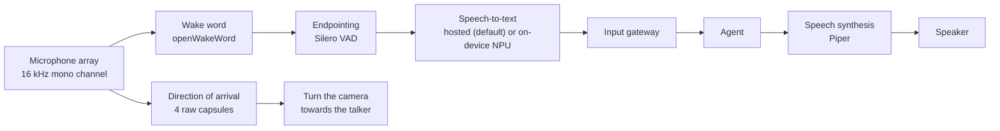
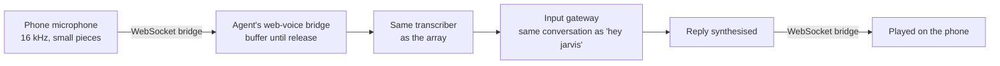

# 3. Voice interaction

[← Back to index](../README.md) · [← 2. The agent](02-ai-agent.md)

> "hey jarvis" … *(rising beep)* … "go to the kitchen"

Scout's voice interface is a complete pipeline: a wake word detected locally, an
endpointer that decides when the sentence finished, speech recognition (hosted
by default, or on the robot's own neural accelerator), the agent, and a spoken
reply synthesised on-device. It runs as threads inside the same process as the
agent, alongside the chat surface, and it can be turned off with a single
setting without affecting chat. It speaks English and Malayalam.

Two more ways to talk reach the same pipeline from a phone: **push-to-talk** in
the web app, which runs a turn in the same conversation as the wake word, and a
**live call**, which lends the robot's microphone and speaker to the phone with
no agent involved.

---

## 3.1 The pipeline

**Nothing in the chain resamples.** The array's first channel is already 16 kHz
mono 16-bit, which is exactly what the wake model, the voice-activity detector
and the transcription endpoint all want.

**Two threads, and a rule about neither blocking.**

- A **capture thread** reads 80 ms frames forever, runs the wake model on each,
  and after a hit runs the endpointer. It never blocks: the capture pipe holds
  only a few hundred milliseconds of audio, so pausing for a transcription — let
  alone a two-minute mission — would overrun it and record gaps.
- A **worker thread** does the encoding, the transcription request and the agent
  call. One command at a time, at most one more pending; past that a wake word
  gets the cancel cue and is dropped, because a queue of minutes-stale commands
  is worse than not hearing them.

---

## 3.2 Wake word: patience instead of a high threshold

The wake model listens for "hey jarvis" locally, and its tuning is a measurement
result rather than a default.

Over 112 real detections on this robot, accepted scores ran from 0.50 up, piling
up against the old 0.5 threshold rather than against 1.0 — the signature of a
threshold cutting through the middle of the true-positive distribution.
Everything just below it was a wake word the robot ignored and a phrase the
person had to repeat. Meanwhile the loudest non-wake audio on hand scored 0.024
(real speech) and 0.011 (room tone), so the high threshold was buying nothing.

The tuning that replaced it:

| Control | Value | Reasoning |
|---|---|---|
| Score threshold | 0.3 | Below where a real wake word actually lands |
| Patience | 2 consecutive frames | A real "hey jarvis" holds the score up for roughly eight frames; a room-noise peak does not hold for two. Costs at most 80 ms |
| Voice gate | optional | Discards a wake hit whose audio carries no voice at all — the cheapest guard against a door slam |
| Debounce | 2 s | One "hey jarvis" should start one capture, not five |

Measured wake scores on this robot: **0.998** for a spoken wake word, **0.024**
for other speech, **0.011** for room tone.

**Near misses are logged**, so tuning is done against what the robot actually
heard rather than against guesses.

---

## 3.3 Endpointing: the 500 ms rule

A voice-activity detector decides when the command ended. Two constants here are
load-bearing:

- **The trailing-silence hangover cannot be tuned below 500 ms.** Whisper-family
  models need a short run of silence after speech to transcribe the final word
  reliably; cutting the hangover clips it. This is documented and tested as a
  floor rather than left as a tuning knob, because it looks like free latency and
  is not.
- **A minimum speech length** discards very short bursts as coughs. One-word
  answers ("yes", "no") measure 300–400 ms spoken and pass, but the margin is
  small — a known limit, watched rather than pre-tuned, since lowering it would
  cost false captures on every wake word too.

End of speech to transcript is about **1.1 s** end to end.

---

## 3.4 Speech recognition: hosted, with an on-device option

Two interchangeable transcribers sit behind one small interface — status, wait
for ready, transcribe — and nothing above that interface knows which is in use.

| | Hosted (what the robot runs) | On-device |
|---|---|---|
| Model | Whisper-large-v3-turbo (809M) | Whisper-base (74M) |
| Where | Hosted API (Groq) | Hailo-10H NPU, over loopback |
| Word error rate | **4.5%** | 16.7% |
| Median latency | **281 ms** | 400 ms |
| Cost to detection frame rate | **none** | about 5% at a realistic duty cycle |
| Works offline | no | **yes** |

Measured on this robot across the agent's own command vocabulary. The on-device
model's failures are not cosmetic — "start **trekking** the person", "drive
**4-2** meters" — and each one is the robot doing the wrong thing or nothing.

**The robot now runs hosted-only.** Since the start of October the NPU's speech
model is switched off and the accelerator is kept for vision: object detection,
face recognition and object finding (see [Perception](04-perception.md)). With
it off, the on-device fallback is off too. Both are a setting and a restart
away, with no code change.

**When both are enabled, fallback is automatic and one-directional.** With the
hosted path selected, a failed request — network down, key rejected, rate
limited — is transcribed on-device instead. The on-device service runs either
way, so the fallback costs nothing until it fires, and a failure degrades
accuracy for one utterance rather than making the robot deaf. A sleeping robot
has its vision service stopped, so an on-device transcription that fails while
asleep wakes the robot, waits for the model, and tries once more.

Three things the hosted path needs that the loopback path does not:

- **Silence is not an empty string.** The on-device service returns nothing for
  silence; a hosted model answers digital silence with a plausible short sentence
  that would otherwise be dispatched as a command. No server-side signal
  distinguishes it — the usual confidence fields sit inside the range of real
  speech — so known artefacts are matched as whole transcripts and mapped back to
  silence. The cost is that a bare "thank you" is ignored; the alternative is
  acting on a sentence nobody said.
- **Connections are held open.** A fresh secure connection costs ~604 ms; a
  pooled one 188–193 ms.
- **Rate limits are respected.** Rate-limit responses are retried against the
  server's own stated delay rather than raised.

### Sharing one accelerator with vision (when on-device is enabled)

On-device transcription runs **inside the NPU vision process**, because the
accelerator is handed out as a single virtual device and a second process asking
for it is refused outright. All consumers therefore share one device and the
runtime's round-robin scheduler time-slices between them. The voice pipeline is
an HTTP client of that endpoint and nothing more — no model, no accelerator
handle of its own. The speech model now runs entirely on the NPU through the
runtime's native speech-to-text interface. Compared with the earlier split
pipeline it loads in 1.6 s instead of about 15, transcribes a 3 s clip in
0.38 s instead of 1.22, and adds about 12 MB of host memory instead of about
500.

That sharing comes with a rule: **one clip per utterance, never streamed, and
nothing retries on its own.** Detection frame rate falls measurably when
transcription is driven hard:

| Speech load | Detection | Accelerator time on speech |
|---|---|---|
| none | 8.06 fps | 0% |
| one command every 5 s (realistic) | 7.67 fps | 7.6% |
| one command every 2 s (heavy) | 7.17 fps | 18.9% |
| back-to-back (synthetic) | 2.36 fps | 98.9% |

A retry loop is the cheapest way to reach the bottom of that table. Wake hits
with no speech behind them are dropped without sending anything at all.

The rule binds the on-device path only. On the hosted path the accelerator is not
in the voice path, so detection keeps its full frame rate.

---

## 3.5 Spoken replies

Replies are synthesised on-device with **Piper**, streamed, and played through the
array's own speaker. Any installed Piper voice can be chosen by asking ("switch
to the lessac voice"). The choice is kept per language, so picking a different
English voice leaves the Malayalam voice alone. Every voice is about the same
size, so the choice is a matter of taste, not latency.

| Measurement | Value |
|---|---|
| Reply to speech starting | 0.45–0.68 s (streamed, voice already loaded) |
| The same, in an earlier subprocess design | 4.8–5.2 s |
| Resident voice model | 133 MB |

**Barge-in works**: starting an utterance stops the current one, so the person can
interrupt. That behaviour is also why announcements block until the speaker has
finished — a fire-and-forget announcement issued *by voice* would be cut off
mid-sentence by the agent's own spoken reply.

**The robot cannot hear itself, by design.** Measured: a wake-word clip played
through the robot's own speaker reaches the microphone at a wake score of 0.0000.
That is what makes barge-in safe and means synthesised speech can never trigger
the robot's own wake word.

### Cue tones

Short tones carry the state of the pipeline without words:

| Cue | Sound | Meaning |
|---|---|---|
| Wake | rising two-tone | Wake word heard — say the command |
| Acknowledge | short blip | Transcribed, the agent is working |
| Cancel | falling two-tone | Nothing heard, not understood, or dropped |
| Alarm | chime | A timer or alarm is going off; its label is spoken after it |
| Call start / end | two-pair ring / falling three notes | A phone has connected to, or hung up on, the room |

---

## 3.6 Answering a question the robot asked

When the agent needs something back — which of two rooms you meant, whether you
want following or just watching, a transcript it did not catch — it reopens the
microphone as soon as it has finished speaking.

> "hey jarvis" … *(beep)* … "move the box"
> "Which box?" … *(beep)* … "the red one"

No second wake word. This exists because the agent's policy already tells it to
ask one short question rather than guess — and until follow-up listening existed,
the robot stopped listening the instant it finished asking. A clarifying question
that costs a wake word is worse than no question at all.

**When it reopens is a setting with three modes.** Originally the agent had to
call `listen_for_reply` explicitly, and in practice it rarely did: the model
reliably ended a reply with a question but often forgot to call the tool first.
So there are now three modes:

| Mode | The microphone reopens… |
|---|---|
| `question` (default) | whenever the reply, as it will actually be spoken, ends in a question mark — or the agent called the tool |
| `tool` | only when the agent called the tool (the original behaviour) |
| `always` | after every spoken reply (what this robot runs, so a conversation flows without repeated wake words) |

All three share the same chain cap and the same barge-in guard described below.

The design constraints are interesting, and they are why the tool that requests
it cannot do the listening itself:

- **Tools run before the reply is spoken.** A tool that listened on the spot would
  open the microphone while the robot was still silent.
- **Only one thread may read the microphone.** The capture thread owns that
  iterator; tools run on the worker thread.

So the request is a single bit handed across three threads: the tool requests it
mid-turn, the turn hands over a token as it ends, the speaker arms it when it
stops talking, and the next audio frame opens the microphone. What follows is an
ordinary capture — same endpointer, same transcription, same cue.

Three deliberate differences from a wake-word capture:

- **No barge-in stop**, because the robot has already finished talking.
- **No new camera bearing.** The look-at-the-speaker hold from the exchange that
  asked the question is still up and still on the person. Releasing and
  re-acquiring would drop a working lock and recentre the camera on the way past —
  the robot visibly looking away at the moment it asks somebody a question.
- **Five seconds to begin answering**, not the wake word's three. After a wake word
  the person is already part-way into the sentence; after a question they have to
  hear it, think, and only then begin.

**One silence ends it, and the robot does not retry.** A falling cancel tone and
it goes back to waiting for the wake word. Chained follow-ups are capped, and the
tool itself is capped within a turn, so a confused exchange cannot become an
interrogation. Follow-up listening can be turned off, in which case every command
needs a wake word again.

---

## 3.7 Looking at whoever spoke

The array's four raw capsules carry enough spatial information to estimate which
direction a sound came from, so Scout turns its camera towards whoever said the
wake word and keeps them in frame for the rest of the exchange — while they
finish speaking, while it works out what to do, and while it answers.

**What ends the hold**, and how it ends, is the whole design:

| Ending | What happens |
|---|---|
| The reply has been spoken | The exchange is over; the camera's return-to-centre countdown is armed |
| The agent needs the camera or the wheels for something the person asked for | The hold releases immediately; driving somewhere else recentres at once |
| The talker is out of the mount's reach | The request is refused and nothing moves — a camera lurching to centre because a talker was unreachable is a thing nobody asked for |

Properties and honest limits:

- **Camera only.** It never interrupts a following task the person actually asked
  for.
- **No lock.** A second person crossing closer to the camera can take the aim;
  the tracker (see [Perception](04-perception.md)) is the feature with a real
  lock behind it.
- **It gives up rather than chasing** a talker past the mount's reach of roughly
  ±50° in pan.
- **One number describes the mounting.** The array prints its own direction scale
  on the board, so the only robot-specific setting is which mark faces the way
  the camera looks. Re-mount the board at a different rotation and that single
  setting is all that changes.
- **The geometry was validated** against the robot's own audio to 0.17 mm of
  residual, which also pinned which channel belongs to which capsule. Low-
  confidence bearings are discarded rather than acted on.
- **Detector confidence is not a speech gate** — tested and rejected as one.

---

## 3.8 Push-to-wake

An optional physical button starts the same capture without a wake word, for a
room too loud for "hey jarvis". It is a single input pin on the host — explicitly
not on the microcontroller, so that pressing it cannot depend on the motion
firmware being alive — and it enters the pipeline at exactly the same point the
wake word does, including the camera bearing. On this robot it is fitted on
the Pi header pin chosen because its neighbours are all harmless: a slipped lead
cannot reach a 5 V pin.

---

## 3.9 Two languages: English and Malayalam

"Switch to Malayalam" — or, on Telegram, a `/language` command, which is the way
back if recognition ever gets bad enough that the robot cannot hear "switch to
English" — changes three things at once. Leaving any one of them behind makes
the other two useless:

| | English | Malayalam |
|---|---|---|
| Speech recogniser | Whisper | **Sarvam**, in code-mix mode |
| Voice | an English Piper voice | a Malayalam Piper voice |
| Agent instructions | answer in English | answer in Malayalam script, briefly |

**Whisper cannot do Malayalam**, and not by a margin tuning would close. On clean
synthetic Malayalam — the easiest audio the robot will ever get — the large
hosted Whisper models returned broken words, Tamil script, Gurmukhi script or
nothing. Sarvam transcribed the same sentence exactly. So Malayalam uses a
different provider, not a different Whisper setting, and has no on-device
fallback.

**Code-mix mode is the important detail.** People in Kerala name rooms and objects
in English, and the robot's places are stored in English. In code-mix mode,
"kitchen-ലേക്ക് പോകൂ" keeps "kitchen" in Latin script, so it reaches navigation
as "kitchen". The same mode means an English sentence spoken in Malayalam mode
comes back as English, which is what makes "switch to English" work. Unlike the
hosted Whisper model, Sarvam really does return an empty string for silence, so
the silence blocklist is not applied there.

**Refused rather than half-done.** Without a Sarvam key the robot refuses to switch,
rather than switching into a language it cannot hear. The choice survives
reboots, and at start-up it is restored only if the setup is still usable. The
wake word and the language model are the same in both languages. Sarvam
measured 0.46–0.80 s per short clip, and its 5 s timeout turns a rare hung
request into a "didn't catch that" tone rather than a robot that stares.

---

## 3.10 Talking from a phone

Every view of the web app has a microphone button. The first tap turns the
phone's microphone on; after that, **hold to talk, release to send**.

- **Push-to-talk needs no wake word and no endpointer.** The press and the release
  are the endpoints. The page keeps about a third of a second from before the
  press and a quarter of a second after the release, so a first word said as the
  thumb lands, or a last word said as it lifts, is kept.
- **The reply plays on the phone**, not on the robot's speaker, unless the agent
  calls a tool whose job is to talk to the room. Each phone turn is marked as
  coming from the phone, so the model knows the person may not be near the robot.
- **No new server or certificate.** Audio rides the WebSocket bridge connection the
  page already holds, at about 32 KB/s each way.
- **One press at a time.** A press while the last one is still being answered is
  refused with a sentence rather than queued. Pressing during the spoken reply
  cuts it off, and a "stop" press pre-empts a running turn like any other stop.
- Measured with a real 6 s recording: the transcript came back **0.64 s** after
  release, and the first reply audio started **0.6 s** after the reply text.

**Limits.** The page has to stay open with the screen on, because mobile browsers
stop the microphone when the tab is hidden; the page holds a screen wake lock
while the microphone is on. Some phones play replies through the earpiece rather
than the loudspeaker while the microphone is open, which is the browser's
choice.

---

## 3.11 Calling the robot

The phone-shaped button on the Drive view's camera starts a **live two-way audio
call**: the phone's microphone comes out of the robot's speaker, and the robot's
microphone comes out of the phone, until either side hangs up. There is no agent
in it — nothing is transcribed or answered. It is the robot's microphone and
speaker, lent to a phone, alongside the live camera.

- **Audio goes over WebRTC, through the same camera server**, as Opus in both
  directions. Only call control (start, keep-alive, end) goes over the WebSocket
  bridge. WebRTC brings the jitter buffer, loss concealment and echo cancellation
  that a home-made audio stream would have had to rebuild.
- **The microphone is shared, not reopened.** The array refuses a second reader,
  so the voice listener feeds the call its own echo-cancelled frames. A tone
  played into the call through the speaker barely registers on that channel,
  so the caller does not hear themselves.
- **The speaker belongs to the call for the whole call.** Wake words and the
  push-to-wake button are ignored, and the speech tools refuse rather than wait.
- **Privacy is stated, not hidden.** Anyone who can open the page on the home
  network can listen through the robot; that is accepted for a trusted home
  network. The room hears a ring when a call starts and a falling tone when it
  ends, and there is only ever one call at a time.
- **A page that disappears is hung up on** after 10 s without a keep-alive, and the
  page hangs up itself when hidden or when it leaves the Drive view. The robot's
  microphone is never left streaming to nobody in particular.
- **Sleep:** a call wakes the robot, because the camera server is one of the units
  sleep stops. Call keep-alives count as activity, and putting the robot to sleep
  ends the call.
- The robot's stream is readable about **0.4 s** after the call starts, and the
  speaker side keeps its delay bounded by trimming any backlog rather than letting
  it grow.

---

## 3.12 Measurements and known limits

Taken on the loaded robot, with voice running inside the agent service:

| | |
|---|---|
| Loaded models (wake + voice activity) | 116 MB resident |
| Wake inference per 80 ms frame | 12.6 ms mean, 18.0 ms p95 (~16% of one core) |
| Detection frame rate with voice idle | 8.03 fps against an 8.06–8.12 baseline — no measurable cost |
| End of speech → transcript | ~1.1 s |
| Reply → speech starts | 0.45–0.68 s |

**Known limits, stated rather than hidden:**

- **Only a bare "stop" pre-empts.** "Stop", "cancel", "never mind" and the like,
  said on their own, halt the robot and end the running turn at once. Anything
  longer ("stop and go to the kitchen") is an ordinary command and queues behind
  the turn in progress.
- **Small speech models are weak on proper nouns.** The wake word is consumed
  before transcription sees the command, so it does not matter here — but nothing
  downstream may rely on exact matching of rare words.
- **One-word answers sit near the minimum clip length** (see §3.3).
- **The acoustic path cannot be self-tested** by playing audio through the robot,
  precisely because the robot cannot hear itself.
- **Mission progress is not spoken**, only the final reply. A two-minute drive is
  silent until it finishes. Telegram and the web app do show progress as text.
- **Hosted recognition needs the network.** With the on-device model switched off
  to keep the accelerator for vision, a robot with no internet connection cannot
  transcribe speech until the on-device model is switched back on.
- **Malayalam has no offline path at all**, because no on-device model handles it.

---

| ← Previous | Next → |
|---|---|
| [2. The agent](02-ai-agent.md) | [4. Perception and vision](04-perception.md) |
