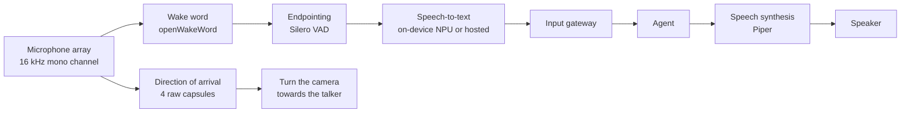

# 3. Voice interaction

[← Back to index](../README.md) · [← 2. The agent](02-ai-agent.md)

> "hey jarvis" … *(rising beep)* … "go to the kitchen"

Scout's voice interface is a complete on-robot pipeline: a wake word detected
locally, an endpointer that decides when the sentence finished, speech
recognition on the robot's own neural accelerator, the agent, and a spoken reply
synthesised on-device. It runs as two threads inside the same process as the
agent, alongside the chat surface, and it can be turned off with a single
setting without affecting chat.

---

## 3.1 The pipeline

**Nothing in the chain resamples.** The array's first channel is already 16 kHz
mono 16-bit, which is exactly what the wake model, the voice-activity detector
and the transcription endpoint all want.

**Two threads, and a rule about neither blocking.**

- A **capture thread** reads 80 ms frames forever, runs the wake model on each,
  and after a hit runs the endpointer. It never blocks: the capture pipe holds
  only a few hundred milliseconds of audio, so pausing for a transcription — let
  alone a two-minute mission — would overrun it and record gaps.
- A **worker thread** does the encoding, the transcription request and the agent
  call. One command at a time, at most one more pending; past that a wake word
  gets the cancel cue and is dropped, because a queue of minutes-stale commands
  is worse than not hearing them.

---

## 3.2 Wake word: patience instead of a high threshold

The wake model listens for "hey jarvis" locally, and its tuning is a measurement
result rather than a default.

Over 112 real detections on this robot, accepted scores ran from 0.50 up, piling
up against the old 0.5 threshold rather than against 1.0 — the signature of a
threshold cutting through the middle of the true-positive distribution.
Everything just below it was a wake word the robot ignored and a phrase the
person had to repeat. Meanwhile the loudest non-wake audio on hand scored 0.024
(real speech) and 0.011 (room tone), so the high threshold was buying nothing.

The tuning that replaced it:

| Control | Value | Reasoning |
|---|---|---|
| Score threshold | 0.3 | Below where a real wake word actually lands |
| Patience | 2 consecutive frames | A real "hey jarvis" holds the score up for roughly eight frames; a room-noise peak does not hold for two. Costs at most 80 ms |
| Voice gate | optional | Discards a wake hit whose audio carries no voice at all — the cheapest guard against a door slam |
| Debounce | 2 s | One "hey jarvis" should start one capture, not five |

Measured wake scores on this robot: **0.998** for a spoken wake word, **0.024**
for other speech, **0.011** for room tone.

**Near misses are logged**, so tuning is done against what the robot actually
heard rather than against guesses.

---

## 3.3 Endpointing: the 500 ms rule

A voice-activity detector decides when the command ended. Two constants here are
load-bearing:

- **The trailing-silence hangover cannot be tuned below 500 ms.** Whisper-family
  models need a short run of silence after speech to transcribe the final word
  reliably; cutting the hangover clips it. This is documented and tested as a
  floor rather than left as a tuning knob, because it looks like free latency and
  is not.
- **A minimum speech length** discards very short bursts as coughs. One-word
  answers ("yes", "no") measure 300–400 ms spoken and pass, but the margin is
  small — a known limit, watched rather than pre-tuned, since lowering it would
  cost false captures on every wake word too.

End of speech to transcript is about **1.1 s** end to end.

---

## 3.4 Speech recognition: on-device, with a hosted option

Two interchangeable transcribers sit behind one small interface — status, wait
for ready, transcribe — and nothing above that interface knows which is in use.

| | On-device (default) | Hosted |
|---|---|---|
| Model | Whisper-base (74M) | Whisper-large-v3-turbo (809M) |
| Where | Hailo-10H NPU, over loopback | Hosted API |
| Word error rate | 16.7% | **4.5%** |
| Median latency | 400 ms | **281 ms** |
| Cost to detection frame rate | 7.67 fps (from 8.12 idle) | **none** |
| Works offline | **yes** | no |

Measured on this robot across the agent's own command vocabulary. The on-device
model's failures are not cosmetic — "start **trekking** the person", "drive
**4-2** meters" — and each one is the robot doing the wrong thing or nothing.

**Fallback is automatic and one-directional.** With the hosted path selected, a
failed request — network down, key rejected, rate limited — is transcribed
on-device instead. The on-device service is running either way, so the fallback
costs nothing until it fires, and a failure degrades accuracy for one utterance
rather than making the robot deaf.

Three things the hosted path needs that the loopback path does not:

- **Silence is not an empty string.** The on-device service returns nothing for
  silence; a hosted model answers digital silence with a plausible short sentence
  that would otherwise be dispatched as a command. No server-side signal
  distinguishes it — the usual confidence fields sit inside the range of real
  speech — so known artefacts are matched as whole transcripts and mapped back to
  silence. The cost is that a bare "thank you" is ignored; the alternative is
  acting on a sentence nobody said.
- **Connections are held open.** A fresh secure connection costs ~604 ms; a
  pooled one 188–193 ms.
- **Rate limits are respected.** Rate-limit responses are retried against the
  server's own stated delay rather than raised.

### Sharing one accelerator with vision

On-device transcription runs **inside the object-detection process**, because the
accelerator is handed out as a single virtual device and a second process asking
for it is refused outright. Both consumers therefore share one device and the
runtime's round-robin scheduler time-slices between them. The voice pipeline is
an HTTP client of that endpoint and nothing more — no model, no accelerator
handle of its own.

That sharing comes with a rule: **one clip per utterance, never streamed, and
nothing retries on its own.** Detection frame rate falls measurably when
transcription is driven hard (8.12 fps idle, 7.30 at one command every two
seconds, 4.38 back-to-back), and a retry loop is the cheapest way to reach the
bottom of that range. Wake hits with no speech behind them are dropped without
sending anything at all.

The rule binds the on-device path only. On the hosted path the accelerator is not
in the voice path, so detection keeps its full frame rate.

---

## 3.5 Spoken replies

Replies are synthesised on-device with **Piper**, streamed, and played through the
array's own speaker.

| Measurement | Value |
|---|---|
| Reply to speech starting | 0.45–0.68 s (streamed, voice already loaded) |
| The same, in an earlier subprocess design | 4.8–5.2 s |
| Resident voice model | 133 MB |

**Barge-in works**: starting an utterance stops the current one, so the person can
interrupt. That behaviour is also why announcements block until the speaker has
finished — a fire-and-forget announcement issued *by voice* would be cut off
mid-sentence by the agent's own spoken reply.

**The robot cannot hear itself, by design.** Measured: a wake-word clip played
through the robot's own speaker reaches the microphone at a wake score of 0.0000.
That is what makes barge-in safe and means synthesised speech can never trigger
the robot's own wake word.

### Cue tones

Three short tones carry the state of the pipeline without words:

| Cue | Sound | Meaning |
|---|---|---|
| Wake | rising two-tone | Wake word heard — say the command |
| Acknowledge | short blip | Transcribed, the agent is working |
| Cancel | falling two-tone | Nothing heard, not understood, or dropped |

---

## 3.6 Answering a question the robot asked

When the agent needs something back — which of two rooms you meant, whether you
want following or just watching, a transcript it did not catch — it reopens the
microphone as soon as it has finished speaking.

> "hey jarvis" … *(beep)* … "move the box"
> "Which box?" … *(beep)* … "the red one"

No second wake word. This exists because the agent's policy already tells it to
ask one short question rather than guess — and until follow-up listening existed,
the robot stopped listening the instant it finished asking. A clarifying question
that costs a wake word is worse than no question at all.

The design constraints are interesting, and they are why the tool that requests
it cannot do the listening itself:

- **Tools run before the reply is spoken.** A tool that listened on the spot would
  open the microphone while the robot was still silent.
- **Only one thread may read the microphone.** The capture thread owns that
  iterator; tools run on the worker thread.

So the request is a single bit handed across three threads: the tool requests it
mid-turn, the turn hands over a token as it ends, the speaker arms it when it
stops talking, and the next audio frame opens the microphone. What follows is an
ordinary capture — same endpointer, same transcription, same cue.

Three deliberate differences from a wake-word capture:

- **No barge-in stop**, because the robot has already finished talking.
- **No new camera bearing.** The look-at-the-speaker hold from the exchange that
  asked the question is still up and still on the person. Releasing and
  re-acquiring would drop a working lock and recentre the camera on the way past —
  the robot visibly looking away at the moment it asks somebody a question.
- **Five seconds to begin answering**, not the wake word's three. After a wake word
  the person is already part-way into the sentence; after a question they have to
  hear it, think, and only then begin.

**One silence ends it, and the robot does not retry.** A falling cancel tone and
it goes back to waiting for the wake word. Chained follow-ups are capped, and the
tool itself is capped within a turn, so a confused exchange cannot become an
interrogation. Follow-up listening can be turned off, in which case every command
needs a wake word again.

---

## 3.7 Looking at whoever spoke

The array's four raw capsules carry enough spatial information to estimate which
direction a sound came from, so Scout turns its camera towards whoever said the
wake word and keeps them in frame for the rest of the exchange — while they
finish speaking, while it works out what to do, and while it answers.

**What ends the hold**, and how it ends, is the whole design:

| Ending | What happens |
|---|---|
| The reply has been spoken | The exchange is over; the camera's return-to-centre countdown is armed |
| The agent needs the camera or the wheels for something the person asked for | The hold releases immediately; driving somewhere else recentres at once |
| The talker is out of the mount's reach | The request is refused and nothing moves — a camera lurching to centre because a talker was unreachable is a thing nobody asked for |

Properties and honest limits:

- **Camera only.** It never interrupts a following task the person actually asked
  for.
- **No lock.** A second person crossing closer to the camera can take the aim;
  the tracker (see [Perception](04-perception.md)) is the feature with a real
  lock behind it.
- **It gives up rather than chasing** a talker past the mount's reach of roughly
  ±50° in pan.
- **One number describes the mounting.** The array prints its own direction scale
  on the board, so the only robot-specific setting is which mark faces the way
  the camera looks. Re-mount the board at a different rotation and that single
  setting is all that changes.
- **The geometry was validated** against the robot's own audio to 0.17 mm of
  residual, which also pinned which channel belongs to which capsule. Low-
  confidence bearings are discarded rather than acted on.
- **Detector confidence is not a speech gate** — tested and rejected as one.

---

## 3.8 Push-to-wake

An optional physical button starts the same capture without a wake word, for a
room too loud for "hey jarvis". It is a single input pin on the host — explicitly
not on the microcontroller, so that pressing it cannot depend on the motion
firmware being alive — and it enters the pipeline at exactly the same point the
wake word does, including the camera bearing.

---

## 3.9 Measurements and known limits

Taken on the loaded robot, with voice running inside the agent service:

| | |
|---|---|
| Loaded models (wake + voice activity) | 116 MB resident |
| Wake inference per 80 ms frame | 12.6 ms mean, 18.0 ms p95 (~16% of one core) |
| Detection frame rate with voice idle | 8.03 fps against an 8.06–8.12 baseline — no measurable cost |
| End of speech → transcript | ~1.1 s |
| Reply → speech starts | 0.45–0.68 s |

**Known limits, stated rather than hidden:**

- **A spoken "stop" queues behind a running mission.** Turns are serialised, and a
  navigation goal blocks for minutes. Pre-empting a running turn needs a
  cancellation path through the mission runner that does not exist yet. The chat
  surface has the same limit; the physical and on-screen overrides do not.
- **Small speech models are weak on proper nouns.** The wake word is consumed
  before transcription sees the command, so it does not matter here — but nothing
  downstream may rely on exact matching of rare words.
- **One-word answers sit near the minimum clip length** (see §3.3).
- **The acoustic path cannot be self-tested** by playing audio through the robot,
  precisely because the robot cannot hear itself.
- **Mission progress is not spoken**, only the final reply. A two-minute drive is
  silent until it finishes.

---

| ← Previous | Next → |
|---|---|
| [2. The agent](02-ai-agent.md) | [4. Perception and vision](04-perception.md) |
