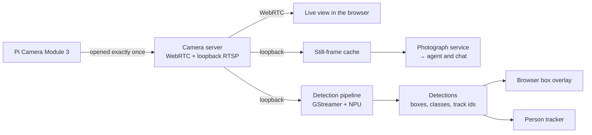
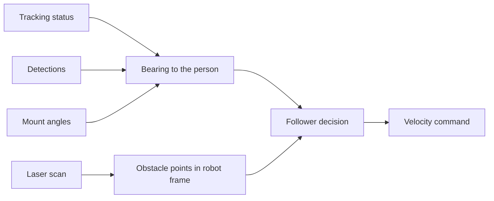

# 4. Perception and vision

[← Back to index](../README.md) · [← 3. Voice](03-voice.md)

Scout sees through one camera on a pan-tilt mount, and that single stream feeds
four consumers at once: a live low-latency view in the browser, still photographs
for the agent, neural-network object detection, and a person tracker that keeps
somebody in frame. This guide covers how one camera serves all of them, what the
accelerator does, and the deliberate difference between *watching* a person and
*following* one.

---

## 4.1 One camera, four consumers

**The camera is opened exactly once.** The platform's camera stack does not
support a second concurrent open, so one native camera server owns the device and
everything else draws from that already-open stream through a loopback-only mux.
This is the single most consequential decision in Scout's vision design: it is
what allows a lagless live view and neural detection and agent photography to be
active simultaneously, with no mode switching.

**Still frames are cached, not fetched on demand.** A continuously refreshed frame
is held in memory, so a photograph request is answered immediately. An earlier
design spawned a decoder per request, racing a full connection and decode against
the camera server's own CPU-bound video encode — several seconds under load, and
sometimes a timeout.

**Detection is capped below the stream rate.** Inference happens on the
accelerator, but the pipeline still spends host CPU on decode and downscaling, so
it is limited to roughly 8 frames per second rather than matching the full stream
— deliberately leaving headroom for the live view's encode rather than reaching
for a mode switch.

---

## 4.2 Object detection on the NPU

Detection runs on a **Hailo-10H neural accelerator** (Raspberry Pi AI HAT+ 2) with
a YOLO-family model and the vendor's post-processing, wrapped in a GStreamer
pipeline. Results are served as JSON on a loopback endpoint, polled at 10 Hz by a
ROS node and republished as a standard detection array topic.

| Property | Detail |
|---|---|
| Classes | COCO classes — person, car, and the rest |
| Per-object identity | The accelerator's tracker supplies a **persistent track ID** across frames |
| Coordinates | Reported in the camera stream's native 1280×720 pixel space, so the browser overlay scales directly against the rendered video |
| Delivery | Detection topic → browser overlay canvas *over* the untouched video element, and → the person tracker, and → the agent's "what do you see" tool |

**Why it can run alongside the live view.** Inference uses the accelerator's own
silicon and onboard memory, so it does not compete with the host's software video
encode the way a CPU-only model would.

**Sharing with speech.** The same host process also serves on-device speech
recognition, because the accelerator is a single virtual device that only one
process may hold. The two consumers time-share it through the runtime's
round-robin scheduler, with matching scheduling and batch settings on both sides.
The coupling is deliberately one-directional: speech never calls into detection,
and every speech failure path degrades to "transcription unavailable" rather than
taking the detection pipeline down. Measured costs are in
[Voice interaction](03-voice.md#34-speech-recognition-on-device-with-a-hosted-option).

**A partial failure is visible.** If the accelerator side stops answering, the
republisher goes quiet rather than publishing an empty list — "no detections
arriving" and "nothing detected" are different facts. The Services page surfaces
that as a partial state rather than as healthy.

---

## 4.3 How the agent sees

The agent has two distinct ways of looking, and they answer different questions:

| Tool | Returns | Good for |
|---|---|---|
| `what_do_you_see` | The current detection list — classes and track IDs | "Is anyone there?", counting, presence |
| `take_picture` | An actual photograph, sent to the person **and shown to the model** | "What's on the table?", "does the door look shut?", anything a label list cannot answer |

The second is what makes Scout's perception feel open-ended. A detector knows
about a fixed set of classes; a vision-capable model looking at the photograph can
describe a room, read a note, or notice that something is out of place. The
mechanics of keeping photographs in the model's view for the whole task — and the
two bugs that taught that lesson — are in
[The agent](02-ai-agent.md#25-vision-in-the-loop-the-model-sees-its-own-photographs).

`show_map` is a third kind of seeing: the live occupancy grid rendered with rooms,
the robot's real footprint and heading, and remembered spots drawn on it, levelled
to the building's own walls so rooms appear as rectangles. It is delivered by the
same path as a photograph, so the person gets the picture and the model gets to
look at it. A map read off disk with nothing localised against it is labelled as
saved and drawn without a robot, rather than showing a confident pose that does
not exist.

---

## 4.4 Aiming the camera

The mount has three would-be owners — operator, agent, tracker — resolved by a
priority multiplexer (see [Architecture](01-architecture.md#15-arbitration-who-gets-the-robot)).
The agent's own aiming tools are built around five decisions:

- **One command is the whole move.** The agent's priority window expires after a
  few seconds, and when it does, an idle mount *holds* rather than recentres. So
  the camera stays where it was put, and a "look" is not a mode with something to
  switch off.
- **Only the axes the person named are set.** "Look up" tilts and leaves the pan
  alone — recentring an axis nobody mentioned takes the camera off whatever they
  were just looking at. Recentring both at once is its own explicit tool.
- **A relative nudge measures from what was last commanded**, not from the joint
  state — which deliberately lags the command, so two quick "further left"s would
  both start from the same stale angle and the second would under-shoot. The
  remembered setpoint is trusted only for as long as the mount could still be
  travelling, and never while the tracker is steering, since then the tracker's
  own commands are the better answer.
- **Aiming during a follow is allowed, and declared.** The mount hands the camera
  back to the tracker when the agent's window expires, which looks like the robot
  changing its mind. The tools do what was asked — silently ending a follow
  somebody requested would be worse — and say in every reply that the tracker is
  about to take the camera back.
- **A direction that is not one is refused.** "Look at the sofa" gets the list of
  valid directions rather than a guess. Aiming a camera somewhere arbitrary and
  reporting success is the worst available answer.

Two mount limits are stated out loud rather than treated as faults, because both
otherwise read as a bug: it **cannot look behind** (pan is roughly ±50°, so that
needs the body to turn), and it tilts far up but only slightly down, so "look
down" usually reports hitting its stop.

### Coming back to centre

"Look around" is composed by the model as a look left, a look right and two
photographs — and it used to end with the camera staring at whichever wall came
last, for the rest of the day. So an aim that leaves the camera off centre is
remembered, and the camera takes itself home once the task that moved it is over.

The scheduling is the whole design, and it lives at a **turn boundary**, not in
the tool that aimed the camera. A countdown started when the camera moves would
fire in the middle of "look left, drive over there, now tell me what you see": the
photograph would come out pointing straight ahead and the model would describe it
as the left-hand view. So each turn cancels any pending return when it starts and
arms a fresh one when it ends — including when it ends in an error, because a
model that failed halfway leaves the camera at a wall just as effectively as one
that succeeded.

A short grace period follows, because a turn ending is not the conversation
ending: "and take another one" a few seconds later cancels the pending return and
gets the view it was promised. Photographs defer it for the same reason. Two
carve-outs: never while following, since the tracker owns the camera then and
stopping a follow does its own walk back to centre; and never for a movement
below the mount's own deadband. A person can also ask the camera to stay put,
which applies to the position they were talking about — a later aim is a fresh
decision, and so is a wake word.

---

## 4.5 Watching a person versus following one

Two things people ask for in almost the same words, kept deliberately distinct:

| | `track_me` | `follow_me` |
|---|---|---|
| Camera | follows the person | follows the person |
| Wheels | **stay put** | turn and drive after them |
| Runs on | camera tracker | camera tracker **and** wheel follower |

A plain "follow me" means the second. "Keep me in shot", "watch me", "track that
phone" mean the first. `stop_following` stops **both**, so the model never has to
work out which is running — and so does `stop_robot`.

**Neither is driven by the agent process.** The agent sends service calls and
nothing else; the wheels are driven on the robot, ten times a second, next to the
laser scanner it is avoiding things with. See
[Architecture §1.2](01-architecture.md#12-why-the-agent-is-not-allowed-to-drive).

### The camera tracker

Keeps a detected person centred by moving **the camera only**. Off at boot,
publishing nothing until told to start, and only the agent ever starts it.

- **Proportional control in pixel space**, integrating onto its **own** setpoint
  rather than onto the reported joint state — which lags during motion and would
  make the loop double-count every step.
- **Candidates are gated on box size, not confidence**, which is documented with
  its reasoning: apparent size is the usable proxy for "the person this is about".
- **Status is published once a second, always**, including while tracking is off —
  silence plus a heartbeat is how a reader tells "off" from "not running".
- **States are distinct**: idle, searching, tracking, lost (they walked out of
  shot), blind (detections have gone silent), at limit (the mount has run out of
  travel).
- **It never stops itself.** Walk out of the room and it stays searching
  indefinitely with the camera held still, and the agent answers "are you still
  following me?" honestly: still looking, nobody found.
- **A restart re-locks onto whoever is nearest now.** That is right for "no, follow
  *me*" and wrong as a reflex, which is why it is capped per turn and never
  re-issued to fix a tracking problem.
- **It returns to centre only after an explicit stop** — never on target loss or
  shutdown, because detection identities churn about once a second and a return
  triggered by "not currently tracking" would throw away a target in plain view.
  A stop is reported as "re-centring over the next few seconds", because a mount
  that keeps moving after "stop" is alarming otherwise.

**Honest tuning limits.** Sensing latency is 277–437 ms, but the closed loop
hunts at 0.41 Hz — implying roughly 0.6 s of total dead time once servo travel and
the mount tick are counted. Measured gain and deadband settings cut the hunting
about threefold (0.28 versus 0.82 direction reversals per second, one lock
identity instead of eighteen) but **do not eliminate it**: the loop is bistable
and still limit-cycles on some runs. The leading suspect is a flagged assumption
in the mount calibration, and the measurement that would settle it is recorded
rather than guessed at.

### The wheel follower

Turns and drives after the tracked person. All of its judgement lives in plain,
ROS-free modules that are tested without a robot; the node around them is only
subscriptions, timers, transforms and the service that turns it on.

- **It refuses to drive unless the camera is already tracking**, and re-checks on
  every control tick. Once the tracker stops reporting a lock for longer than a
  flicker, forward driving stops. That invariant is enforced where the motors are,
  not assumed by the caller.
- **Silence is the test.** On a booted robot the follower's velocity topic prints
  nothing at all and its status says idle once a second. While running, *holding
  still publishes zeros* rather than going quiet — zeros keep its claim on the
  velocity arbiter, whereas silence would hand the robot to whatever else is
  publishing.
- **Honest limits, all seen on the real robot:**
  - It **cannot keep up with anyone actually walking** — roughly 0.55 m/s against a
    walking pace of 1.2–1.4. This is the machine, not a tuning problem, and it is
    stated on every start rather than letting the person conclude it is broken.
  - It holds about **1.5 m** back and stops the wheels the instant it loses sight
    of you, rather than driving on towards where you used to be.
  - **Blocked, lost and no-range are three different facts.** Blocked is knowing
    exactly where you are with no way through; lost is you being gone from view;
    no-range is seeing you but being unable to measure distance — somebody sitting
    on a sofa is above the scanner's slice entirely. It stops rather than guessing.
  - **It steers around what the scanner sees; it does not plan a route.** No map,
    no costmap, no memory, so it sits down in local minima — a U of furniture, a
    doorway not squarely approached — and says it is blocked rather than solving
    them.
  - **The scanner sees one slice**, about 20 cm off the floor: blind to glass, to
    table tops, to anything lower — and to a step down or a staircase, which
    nothing on this robot can see at all.
  - A person much beyond **~8 m** cannot be locked onto at all, the mount's limited
    downward tilt means somebody standing very close leaves the bottom of frame,
    and a second person crossing the frame will not steal the camera, by design.

### Starting and stopping safely

Starting a follow is **two calls, camera first**. If the wheels then refuse, the
camera tracking is stopped again rather than left running on its own. A freshly
started robot reports blind for a second or two before its first detections
arrive, so a blind start is retried **once** after a couple of seconds — past that
it is a genuinely dead pipeline and the person should hear so rather than watch a
loop. A build with no tracker, or a tracker with no follower, is reported as
"unavailable on this robot" with no call issued at all, rather than hanging on a
service that does not exist — and a tracker without a follower answers "follow me"
by offering to watch instead.

---

| ← Previous | Next → |
|---|---|
| [3. Voice interaction](03-voice.md) | [5. Navigation and autonomy](05-navigation.md) |
