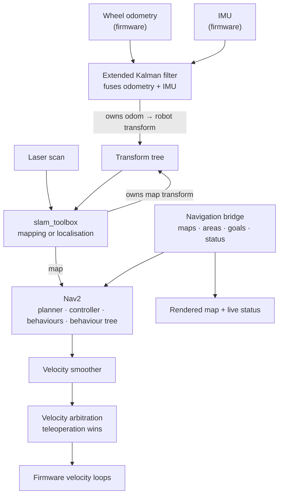
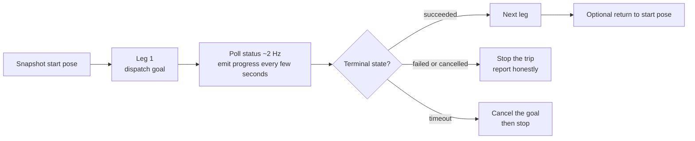

# 5. Navigation and autonomy

[← Back to index](../README.md) · [← 4. Perception](04-perception.md)

Scout navigates a house by room name. "Go to the kitchen and come back" is a
single sentence that becomes a multi-leg trip across a live map, with progress
reported while it happens and a plain-English account of how it ended.

---

## 5.1 The estimation and navigation stack

| Component | Role |
|---|---|
| **Extended Kalman filter** | Fuses the firmware's wheel odometry with the IMU at 30 Hz in planar mode, and is the sole owner of the odometry-to-robot transform. Which IMU fields are accepted and which are rejected is documented in its configuration. |
| **slam_toolbox** | Builds maps on demand in asynchronous mode; in localisation mode it localises against a saved map. Either way it owns the map transform — which is why the two modes are mutually exclusive. |
| **Nav2** | Global planner, an MPPI controller behind a rotation shim, recovery behaviours, a velocity smoother and a behaviour-tree navigator. Also supplies the measured drive/turn/spin behaviours the agent's relative-movement tools use. |
| **Navigation bridge** | The single service surface for goals, maps and named areas, plus a rendered map view and a live status stream at 10 Hz. Everything above it — the web map page and the agent alike — speaks to this. |

Mapping and navigating are **one service each and cannot coexist**: both would
publish the same map transform, and two disagreeing estimates flipping many times
a second reads as a localisation bug rather than a configuration mistake. The
service manager enforces it, so starting either stops the other.

---

## 5.2 Rooms instead of coordinates

Scout's map carries **named, oriented rectangular areas** — "Kitchen", "Hall".
That one modelling choice is what makes natural-language navigation work.

- **Names are free-form and not unique**, and area identifiers are opaque. So what
  a person says is resolved case- and whitespace-insensitively, falling back to a
  substring match, and answering with a **question** when several rooms match or
  with **the list of real names** when none does — never with a guess. An
  identifier is accepted directly too, which is how a person answers "which
  bedroom did you mean?".
- **An area goal completes when the robot is inside the rectangle**, not when the
  planner reaches the single point it aimed at.
- **"Which room am I in" is asked of the robot**, which already owns that
  containment test. No geometry is duplicated in the agent, so the two cannot
  drift apart.
- **Areas know their own angle**, which is also what lets the map be drawn levelled
  to the building's walls rather than to the map frame's arbitrary axes.

Named areas can be created from the phone (drag out a box on the map page) or by
asking the robot to name where it is standing.

---

## 5.3 Multi-leg missions

The robot's goal interface is one-shot. Trips are made out of it by a mission
runner in the agent:

The behaviours that matter:

- **Progress, not silence.** A progress line every few seconds; the chat surface
  posts one message and edits it in place, so a two-minute drive shows a shrinking
  distance-to-go.
- **A timeout cancels the goal** rather than merely giving up on waiting — the
  alternative is a returned error and a robot still driving.
- **The trip stops at the first leg that does not succeed**, because after a failed
  leg the robot is not where the rest of the trip assumed it would be.
- **"Come back" is synthesised.** There is no return-to-start command on the robot,
  so the start pose is captured before the first leg and the trip finishes with a
  goal back to it — landing within the planner's tolerance (about 0.12 m), not
  exactly on the spot, which is what the reply says.
- **Navigation is started when needed.** If a goal is requested while navigation is
  not running, the agent starts it, waits up to a minute, and reports the wait. If
  that stops an in-progress mapping session and discards an unsaved map, it says
  so in the conversation, so the loss is visible rather than silent.

### What the agent will not do

- **Send a goal when the robot does not know where it is.** An invalid pose means
  it would drive somewhere arbitrary.
- **Send a goal on a map that is drawable but not navigable.**
- **Touch the protected services** — the serial bridge to the microcontroller
  (opening its port resets the board and drops motor state mid-motion) or the
  web/bridge stack it is itself talking over.

### Overrides

`stop_robot` cancels any active goal *and* zeroes the velocity, and is never gated
behind a confirmation. Stopping a follow is the same: it takes no arguments, works
from every state including when nothing is running, and is never held back for a
confirmation. Manual driving is an override in its own right — any non-zero
teleoperation command cancels an active goal on the robot side.

---

## 5.4 Relative movement, done properly

"Move forward one metre" used to mean publishing a fixed velocity for a number of
seconds. Seconds are not metres on a tracked base: the tracks slip, the smoother
ramps, a busy host publishes late — and nothing on that path was looking at the
laser scanner, so "forward" drove into whatever was in front.

Relative moves are now **navigation goals** running the planner's own measured
drive, back-up and spin behaviours. That means they are:

- measured on odometry rather than timed,
- **stopped short of obstacles** on the local costmap,
- cancellable and reportable like any other goal,
- bounded (5 cm to 3 m; 5° to 360°), with a request past those limits answered in
  words rather than as a bare refusal.

A useful acceptance check: asking for one metre forward towards a wall 1.5 m away
should stop about half a metre short and say why.

---

## 5.5 Directions, remembered spots and the map picture

| Capability | Behaviour |
|---|---|
| `distance_and_direction` | Straight-line distance from the current pose to a room's centre or a remembered spot, a **body-relative** direction ("ahead and to my left"), and the turn that faces it. Never a compass point, because the map frame's axes are arbitrary. It is not a route length, and says so. |
| `remember_this_spot` | Labels the current pose for this session. Tied to the map it was recorded on, and refused on any other. |
| `name_this_place` | The permanent version — writes a named area to the map. |
| `go_back` | Drives to a labelled spot, or with no label to wherever the last trip started. Small nudges and "go back" itself do not overwrite that departure point, so "go back" after edging forward still means the room it came from. |
| `show_map` | Fetches the latched rendered map the web page already uses, draws rooms, the robot and remembered spots on it, levels it to the walls, and delivers it as a picture. Subscribed on demand rather than held open, since mapping republishes a full image every few seconds. |

The robot's pose is drawn **only on a live view**. A map read off disk is labelled
as saved and drawn without a robot, because a picture the robot is not localised
in should not show a confident position.

---

## 5.6 Mapping from a phone

The web map page runs the whole workflow without a terminal: **new map → drive
around → save map → navigate**. Those three actions switch the mapping and
navigation services through the same allowlisted path the Services page uses. The
page also offers tap-to-navigate, tap-a-room-label to drive into it, drag-out to
create a room, pan and pinch zoom, and a "set position" gesture — press where the
robot really is and drag the way it faces — for seeding localisation.

With nothing running it draws the saved map off disk and says so, because a
picture the robot is not using should be labelled as one.

---

## 5.7 Tuning a tracked base: what the robot taught

Tracked chassis are not differential-drive textbook robots, and several
navigation settings on Scout exist because of measured behaviour. These are
documented here because they are the interesting part of making autonomy work on
real hardware.

- **In-place rotation has to break stiction.** With a narrow track separation, a
  spin puts very little linear speed at each track, and below a threshold the
  tracks cannot break static friction — the robot buzzes without turning. Worse,
  the sampling controller returns a cost-weighted *average* of its candidate
  trajectories, and the average of "turn left" and "turn right" is near zero, so
  it is structurally unable to choose a tank turn. The fix is a **rotation shim**
  ahead of the main controller, with a rotation speed above the stall point, an
  acceleration limit high enough to cross that point within a tick or two, and an
  open-loop ramp — because ramping from *measured* speed while stalled clamps
  itself below breakaway and deadlocks.
- **A velocity deadband cannot substitute for that.** Two deadbands (one stopping
  the controller from *proposing* a creep, one zeroing whatever still arrives)
  keep a small angular term on purpose: stiction is a standstill problem owned by
  the rotation shim, and once the tracks are already sliding, a gentle correction
  executes fine. Raise the angular deadband to stiction levels and the robot can
  only swerve or go straight — so it weaves, or circles a goal directly ahead.
- **One acceleration limit written in three places means the smallest wins**, since
  each stage re-limits the one before it. A launch-time check warns when they
  drift apart, because nothing else logs it: the controller publishes exactly what
  it intended and a downstream node quietly flattens it.
- **Arriving "facing anywhere" is a decision.** The map frame sits at an arbitrary
  angle to the building, so a goal with no requested heading and a tight heading
  tolerance makes the robot pivot to an arbitrary direction after arrival — with no
  linear error left, the correction comes out rotation-only and below breakaway.
  Accepting any final heading, and disabling the critic that pushes for one, are
  **one decision** to be revisited together if the interface ever grows a way to
  say "arrive facing this way".
- **Gaps between critic thresholds strand the robot.** Between two mismatched
  "close enough to consider" distances, neither critic drives the robot forward:
  the goal is accepted, the robot sits still, and it fails in recovery behaviours.
- **One publisher per velocity topic, always.** Two publishers interleave at many
  hertz and last writer wins, which presents as stuttering rather than as a
  configuration error.

---

| ← Previous | Next → |
|---|---|
| [4. Perception and vision](04-perception.md) | [6. Robot platform](06-platform.md) |
