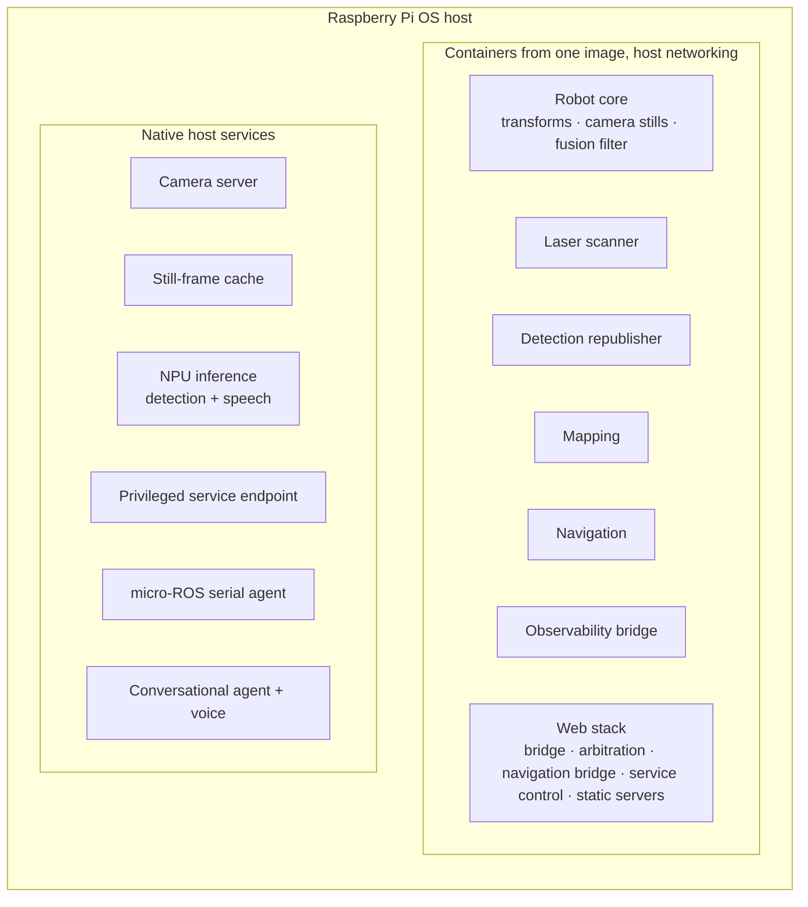

# 6. Robot platform

[← Back to index](../README.md) · [← 5. Navigation](05-navigation.md)

[`scout_ws`](https://github.com/Xmindz/scout_ws) is the ROS 2 workspace that owns
the robot's physical truth: sensing, estimation, mapping, navigation, camera
streaming, person tracking and following, process supervision, and the browser
control surfaces. It is the layer the agent asks, and the layer an operator can
drive directly from a phone.

---

## 6.1 Packages

| Package | Contents |
|---|---|
| **Bringup** | Launch descriptions and parameter sets — one file per subsystem, so each can be run alone against a live robot, and each has a matching system service. |
| **Description** | The robot's geometric model: chassis, two continuous track joints, IMU, laser scanner and the camera mount chain, composed into one model. |
| **Interfaces** | Custom service definitions: take a picture, control a service, navigation commands, tracking commands. |
| **Nodes** | Python nodes for camera stills, detection republishing, terminal driving, camera-mount arbitration and modelling, mount calibration, person tracking, person following and host health. |
| **Web** | The browser pages plus the nodes behind them: velocity arbitration, service control, the navigation/map bridge and an HTTPS server. |

Third-party drivers (the laser scanner driver, the micro-ROS agent sources and
its message definitions) are vendored checkouts rather than maintained here.

---

## 6.2 Nodes and what each is responsible for

| Node | Responsibility |
|---|---|
| **Camera stills** | Serves the take-a-picture service by fetching one cached frame from the host-side still-frame helper. |
| **Detection republisher** | Polls the host-side accelerator endpoint at 10 Hz and republishes results as a standard detection array. |
| **Mount multiplexer** | Priority arbitration for the camera mount — operator, then agent, then tracker — down onto the single command the firmware subscribes to. Publishes on change with a deadband and a rate ceiling rather than on a clock, plus a periodic keepalive so a microcontroller reset cannot leave the servos and the multiplexer disagreeing. **Idle means hold, not recentre.** |
| **Mount state model** | Models the servos from the commanded angles onto joint states at 20 Hz, which is what gives the transform publisher anything to say about the mount. Open-loop by necessity — the servos have no feedback — so this is where the camera was *told* to point. |
| **Mount calibration** | The single place true camera angles and firmware servo angles meet, holding the keying offsets, the scale corrections and the measured mechanical stops that actually protect the servos. |
| **Person tracker** | Camera-only person tracking with its own setpoint, box-size candidate gating, and a status heartbeat that distinguishes lost from blind. See [Perception](04-perception.md). |
| **Person follower** | Drives the base after a tracked person, refusing to drive without a lock, with all judgement in ROS-free modules tested without a robot. |
| **Velocity arbitration** | Relays teleoperation (priority) or navigation output to the robot at 10 Hz, zeroing output if nothing has arrived on either input for ~0.4 s. The deliberate rate is not raised: a faster relay was tried and made teleoperation jittery. |
| **Service control** | Publishes the status of every system unit once a second and serves start/stop/restart/enable/disable requests, by talking to a loopback endpoint on the host. |
| **Navigation bridge** | Backs the map page and the agent: a rendered map view with metadata and the measured wall angle (latched), live status at 10 Hz, and one service covering goals, relative motion, saved maps and named areas. Also cancels the active goal when teleoperation goes non-zero. |
| **Host health** | Publishes the computer's own health once a second — processor temperature, load, available memory, free disk, uptime and a one-word verdict. Nothing else reports on the machine the rest of the stack runs on, and thermal throttling degrades all of it without raising a single error. |
| **Terminal driving** | An interactive keyboard drive for bench work, with an auto-stop per command. |

---

## 6.3 Interfaces at a glance

Commands in:

| Interface | Purpose |
|---|---|
| Teleoperation velocity | Browser driving — highest priority at the arbiter |
| Navigation velocity | Planner output, after smoothing |
| Mount commands (operator / agent / tracker) | Three prioritised inputs in **true camera angles** |
| Take a picture | One JPEG still, returned in the response |
| Navigation command | Goals, relative motion, map management, named areas, "which room am I in" |
| Tracking command | Start / stop / status for camera tracking |
| Follow command | Start / stop / status for wheel following |
| Service control | Allowlisted unit actions |
| Initial pose | Seeding localisation from the map page |

Facts out:

| Interface | Content |
|---|---|
| Wheel odometry, IMU, battery state | From the firmware over micro-ROS |
| Filtered odometry + transform | From the fusion filter |
| Laser scan | 360°, 10 Hz |
| Map and metadata | From mapping or localisation, whichever is running |
| Rendered map view | Occupancy grid as an image plus resolution, origin, bounds and wall angle — latched |
| Navigation status | Mode, live pose, goal state, 10 Hz |
| Detections | Boxes, classes, confidences and persistent track IDs |
| Tracking status / follow status | One JSON heartbeat each per second, published whether or not the feature is active |
| Service status | Every unit's run and boot state, once a second, latched |
| Host health | Once a second |
| Mount joint states | 20 Hz, commanded rather than measured |
| Control-loop telemetry | Firmware internals, diagnostics only |

Two conventions run through this table:

- **A heartbeat is published even when a feature is off**, so that a reader can
  distinguish "off" from "not running". Silence means the node is absent.
- **A service accepting a request is not the same as the request having taken
  effect.** Service-control actions are dispatched without blocking, because a
  cold start can take minutes; the status stream is what says what actually
  happened.

---

## 6.4 Runtimes, containers and supervision

- **One feature, one service.** Sensors and estimators used to share launch files
  with the things that depend on them, so neither could be restarted without the
  other — and a scanner hiccup cost the whole transform tree. Each is now
  independently startable, and the system's own process supervisor does the
  supervision rather than a hand-written one.
- **Development mode is explicit.** Running a launch file by hand alongside the
  services produces two drivers fighting over one serial port, so there is a
  documented way to stand the services down first.
- **Deployment files are source, not live.** Unit definitions live in the
  repository and are installed; the distinction is called out because editing the
  wrong copy is the obvious mistake.
- **Container messaging is pinned to UDP.** The default middleware prefers shared
  memory between same-host participants, which separate containers do not share —
  discovery succeeds while traffic silently disappears, presenting as a service
  call that hangs forever.

---

## 6.5 Browser control surfaces

Every page is phone-friendly and talks to the robot over the same WebSocket
bridge the agent uses.

| Page | What it does |
|---|---|
| **Drive** | Hold-to-drive D-pad and arrow keys, speed slider, live camera view with the detection overlay drawn on a canvas above the untouched video. |
| **Throttle** | Car-style alternative: sticky vertical throttle, a drive/neutral/reverse selector, momentary turn buttons. |
| **Pan/tilt** | Aim the camera with the phone's own gyroscope — which needs a secure context, and is why the pages are also served over TLS. |
| **Map** | The occupancy grid with the robot's real footprint and heading at map scale, levelled to the building's walls, named rooms drawn as rectangles, tap-to-navigate, drag-to-create-a-room, and a mode-aware sheet that runs the whole mapping workflow. |
| **Services** | Live status of every unit with independent run and boot controls, dependency warnings and type-to-confirm on the dangerous ones. |

Supporting pieces: a WebRTC client with its own reconnect loop, a detection
overlay, a battery gauge, and a shared menu. The control pages auto-reconnect and
the bridge pings its sockets, so a dropped link is detected in seconds rather than
sitting open indefinitely — which matters on a mesh network the robot roams
across.

---

## 6.6 Network endpoints

| Port | Service |
|---|---|
| 8080 / 8443 | Web pages over HTTP and TLS |
| 9090 / 9091 | WebSocket bridge, plain and TLS |
| 8889 | WebRTC signalling for the live camera |
| 8765 | Observability bridge |
| 8554 | Camera mux — **loopback only** |
| 8890 | Still-frame cache — **loopback only** |
| 8891 | NPU inference (detection + speech) — **loopback only** |
| 8700 | Privileged service endpoint — **loopback only** |

> **Security posture, stated plainly.** None of the network-facing endpoints has
> authentication. Anyone who can reach the robot can drive it and start or stop
> its services. The privileged side is bounded by an exact-string allowlist, so
> the worst it grants is disruption of known units — but that is a bound on one
> path, not a security model for the robot. Scout is built for a trusted home
> network, and should not be placed on an untrusted one. This is called out in the
> project's own documentation rather than left for a reader to discover.

---

## 6.7 Observability

- An **observability bridge** exposes the whole live system to a standard
  visualisation client — topics, transforms, the map, the scan — as a separate
  service that can be switched on only when needed.
- **Every subsystem publishes its own health** on a heartbeat, including the host
  computer.
- **Firmware logs are relayed** into the same log stream as everything else, so a
  microcontroller message and a planner message appear in one place.
- Diagnostic telemetry from the control loops is published on its own topic, with
  selectable content, so a bring-up measurement can be watched live.

---

| ← Previous | Next → |
|---|---|
| [5. Navigation and autonomy](05-navigation.md) | [7. Motion firmware](07-firmware.md) |
