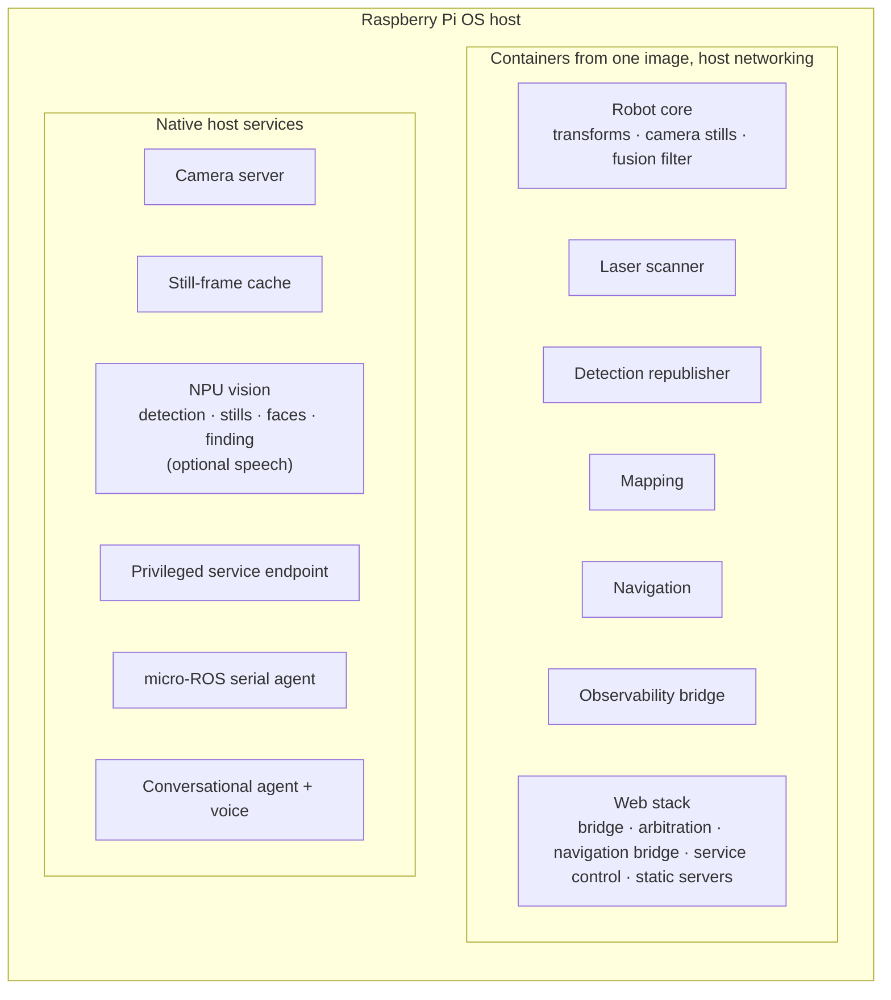

# 6. Robot platform

[← Back to index](../README.md) · [← 5. Navigation](05-navigation.md)

[`scout_ws`](https://github.com/Xmindz/scout_ws) is the ROS 2 workspace that owns
the robot's physical truth: sensing, estimation, mapping, navigation, camera
streaming, the NPU vision services, person tracking and following, process
supervision, and the phone web app. It is the layer the agent asks, and the
layer an operator can drive directly from a phone.

---

## 6.1 Packages

| Package | Contents |
|---|---|
| **Bringup** | Launch descriptions and parameter sets — one file per subsystem, so each can be run alone against a live robot, and each has a matching system service. |
| **Description** | The robot's geometric model: chassis, two continuous track joints, IMU, laser scanner and the camera mount chain, composed into one model. |
| **Interfaces** | Custom service definitions: take a picture, control a service, navigation commands, tracking commands. |
| **Nodes** | Python nodes for camera stills, detection republishing, terminal driving, camera-mount arbitration and modelling, mount calibration, person tracking, person following and host health. |
| **Web** | The single-page web app plus the nodes behind it: velocity arbitration, service control, the navigation/map bridge with its scan-to-map localiser, and an HTTPS server that also forwards the camera's WebRTC signalling. |

Alongside the packages, the repository holds the host-native services' deployment
files: the camera server, the still-frame cache, the NPU vision service (object
detection, stills, face recognition, open-vocabulary finding and optional speech
recognition), and the privileged service endpoint.

Third-party drivers (the laser scanner driver, the micro-ROS agent sources and
its message definitions) are vendored checkouts rather than maintained here.

---

## 6.2 Nodes and what each is responsible for

| Node | Responsibility |
|---|---|
| **Camera stills** | Serves the take-a-picture service by fetching one cached frame from the host-side still-frame helper, which normally takes it from the NPU vision pipeline's own decode. |
| **Detection republisher** | Polls the host-side accelerator endpoint at 10 Hz and republishes results as a standard detection array. |
| **Mount multiplexer** | Priority arbitration for the camera mount — operator, then agent, then tracker — down onto the single command the firmware subscribes to. Publishes on change with a deadband and a rate ceiling rather than on a clock, plus a periodic keepalive so a microcontroller reset cannot leave the servos and the multiplexer disagreeing. **Idle means hold, not recentre**, and a command overridden by a higher-priority source is never resumed. |
| **Mount state model** | Models the servos from the commanded angles onto joint states at 20 Hz, which is what gives the transform publisher anything to say about the mount. Open-loop by necessity — the servos have no feedback — so this is where the camera was *told* to point. |
| **Mount calibration** | The single place true camera angles and firmware servo angles meet, holding the keying offsets, the scale corrections and the measured mechanical stops that actually protect the servos. |
| **Person tracker** | Camera-only person tracking with its own setpoint, box-size candidate gating, and a status heartbeat that distinguishes lost from blind. See [Perception](04-perception.md). |
| **Person follower** | Drives the base after a tracked person, refusing to drive without a lock, with all judgement in ROS-free modules tested without a robot. |
| **Velocity arbitration** | Relays teleoperation (priority) or navigation output to the robot at 10 Hz, zeroing output if nothing has arrived on either input for ~0.4 s. The deliberate rate is not raised: a faster relay was tried and made teleoperation jittery. |
| **Service control** | Publishes the status of every system unit once a second and serves start/stop/restart/enable/disable requests, plus reboot and shut down for the Pi itself, by talking to a loopback endpoint on the host. |
| **Navigation bridge** | Backs the map view and the agent: a rendered map view with metadata and the measured wall angle (latched), live status at 10 Hz including the localisation verdict, and one service covering goals, relative motion, saved maps, named areas, localisation checks and relocalisation. Checks localisation before every goal, and cancels the active goal when teleoperation goes non-zero. See [Navigation §5.3](05-navigation.md#53-knowing-where-it-is). |
| **Host health** | Publishes the computer's own health once a second — processor temperature, load, CPU usage, available memory and swap, free disk, uptime and a one-word verdict. Nothing else reports on the machine the rest of the stack runs on, and thermal throttling degrades all of it without raising a single error. |
| **Terminal driving** | An interactive keyboard drive for bench work, with an auto-stop per command. |

---

## 6.3 Interfaces at a glance

Commands in:

| Interface | Purpose |
|---|---|
| Teleoperation velocity | Browser driving — highest priority at the arbiter |
| Navigation velocity | Planner output, after smoothing |
| Mount commands (operator / agent / tracker) | Three prioritised inputs in **true camera angles**; the operator's comes from dragging the video |
| Take a picture | One JPEG still, returned in the response |
| Navigation command | Goals, relative motion, map management, named areas, "which room am I in", check localisation, relocalise |
| Tracking command | Start / stop / status for camera tracking |
| Follow command | Start / stop / status for wheel following |
| Service control | Allowlisted unit actions |
| Reboot / shut down | The Pi itself, from the Status view |
| Initial pose | Seeding localisation from the map view, or from a relocalisation |
| Sleep command | Sleep, wake or status, from the web app to the agent |
| Web voice / web call / activity requests | From the web app to the agent: push-to-talk audio, call control, activity-log queries |

Facts out:

| Interface | Content |
|---|---|
| Wheel odometry, IMU, battery state | From the firmware over micro-ROS |
| Filtered odometry + transform | From the fusion filter |
| Laser scan | 360°, 10 Hz |
| Map and metadata | From mapping or localisation, whichever is running |
| Rendered map view | Occupancy grid as an image plus resolution, origin, bounds and wall angle — latched |
| Navigation status | Mode, live pose, goal state, localisation verdict (ok / doubtful / lost), 10 Hz |
| Sleep status | Asleep or awake, since when, why a sleep would be refused, the idle countdown — published by the agent once a second and on change, **not** latched, so silence means the agent is not running |
| Web voice / web call / activity replies | From the agent to the web app: transcripts, progress, replies and reply audio; call state; activity lists and details |
| Detections | Boxes, classes, confidences and persistent track IDs |
| Tracking status / follow status | One JSON heartbeat each per second, published whether or not the feature is active |
| Service status | Every unit's run and boot state, once a second, latched |
| Host health | Once a second |
| Mount joint states | 20 Hz, commanded rather than measured |
| Control-loop telemetry | Firmware internals, diagnostics only |

Two conventions run through this table:

- **A heartbeat is published even when a feature is off**, so that a reader can
  distinguish "off" from "not running". Silence means the node is absent.
- **A service accepting a request is not the same as the request having taken
  effect.** Service-control actions are dispatched without blocking, because a
  cold start can take minutes; the status stream is what says what actually
  happened.

---

## 6.4 Runtimes, containers and supervision

- **One feature, one service.** Sensors and estimators used to share launch files
  with the things that depend on them, so neither could be restarted without the
  other — and a scanner hiccup cost the whole transform tree. Each is now
  independently startable, and the system's own process supervisor does the
  supervision rather than a hand-written one.
- **Development mode is explicit.** Running a launch file by hand alongside the
  services produces two drivers fighting over one serial port, so there is a
  documented way to stand the services down first.
- **Deployment files are source, not live.** Unit definitions live in the
  repository and are installed; the distinction is called out because editing the
  wrong copy is the obvious mistake.
- **Container messaging is pinned to UDP.** The default middleware prefers shared
  memory between same-host participants, which separate containers do not share —
  discovery succeeds while traffic silently disappears, presenting as a service
  call that hangs forever.

---

## 6.5 The web app

The browser interface is a **single-page app**: one page, one WebSocket bridge
connection, and four views switched from a bottom tab bar on a phone (or a side
rail on a wider screen). Views are shown and hidden rather than reloaded, so the
map keeps its pan and zoom across a switch. Bookmarks to the old separate pages
redirect to the matching view.

<table>
  <tr>
    <td align="center" width="25%"></td>
    <td align="center" width="25%"></td>
    <td align="center" width="25%"></td>
    <td align="center" width="25%"></td>
  </tr>
  <tr>
    <td align="center"><b>Drive</b></td>
    <td align="center"><b>Map</b></td>
    <td align="center"><b>Activity</b></td>
    <td align="center"><b>Status</b></td>
  </tr>
</table>

| View | What it does |
|---|---|
| **Drive** | Live camera with the detection overlay drawn on a canvas above the untouched video. **Drag the video to aim the camera**, double-tap to recentre. Two control styles on a toggle: **D-Pad** (hold-to-drive and arrow keys, speed slider) and **Throttle** (sticky throttle, drive/neutral/reverse, momentary arc turns). A **call button** on the video starts a live two-way audio call with the room. |
| **Map** | The occupancy grid with the robot's real footprint and heading at map scale, levelled to the building's walls, named rooms drawn as rectangles, chips for navigation state, the active map and the localisation verdict, tap-to-navigate, drag-to-create-a-room, "set position", and a mode-aware sheet that runs the whole mapping workflow. |
| **Activity** | What the agent has been asked to do, newest first: the source (Telegram, voice, phone, scheduled), the request, the reply, duration, and model and tool call counts, with the tools used as chips. Tapping one shows every step. A "New session" button starts a fresh conversation. See [The agent §2.16](02-ai-agent.md#216-watching-the-agent-work). |
| **Status** | Robot tiles (battery charge and voltage; awake or asleep, tap to toggle), Pi tiles (CPU temperature, CPU usage and load, memory, swap), and the live service list with independent run and boot controls, dependency warnings and type-to-confirm on the dangerous ones. Units stopped by sleep read "stopped (asleep)" rather than as failures. Type-to-confirm **Reboot Pi** and **Shut down Pi** buttons. Tiles fall back to a dash after a few seconds without data. |

On every view:

- **The app bar** shows the sleep pill (a sun when awake, a moon when asleep,
  "unknown" when the agent is silent), the battery gauge, and the connection
  state.
- **A floating microphone button** is push-to-talk to the agent from the phone
  (see [Voice §3.10](03-voice.md#310-talking-from-a-phone)).

Two behaviours matter more than they look:

- **Teleoperation is silent when idle, and stops when you look away.** The velocity
  arbiter treats *any* recent teleoperation message, a zero included, as the
  operator holding the controls, and ranks it above following and navigation. So
  the Drive view publishes only while a button is held or the throttle is in
  gear, and sends one zero when that ends. The old standalone throttle page
  published zeros continuously and blocked every navigation goal while it was
  open. Because switching views no longer unloads the page, leaving the Drive
  view, switching control style, backgrounding the tab, the window losing focus
  or the socket dropping all stop the robot and put the throttle back to
  neutral.
- **The app auto-reconnects** and the bridge pings its sockets, so a dropped link
  is detected in seconds rather than sitting open indefinitely — which matters on
  a mesh network the robot roams across. The camera has its own reconnect loop,
  and is pulled only while the Drive view is on screen.

**Use the HTTPS address.** The phone microphone (push-to-talk and calls) is only
available to a secure page, so the app is served over TLS as well as plain HTTP.
The camera server's WebRTC signalling is plain HTTP, which a secure page may not
fetch, so the app's own HTTPS server forwards it. Over HTTPS, then, everything
works, including the camera.

The old gyroscope-driven pan/tilt page has been removed; dragging the video
replaced it.

---

## 6.6 Network endpoints

| Port | Service |
|---|---|
| 8080 / 8443 | Web app over HTTP and TLS (TLS also forwards camera and call signalling) |
| 9090 / 9091 | WebSocket bridge, plain and TLS |
| 8889 | WebRTC signalling for the live camera and the call audio |
| 8765 | Observability bridge |
| 8554 | Camera mux, and call audio to and from the agent — **loopback only** |
| 8890 | Still-frame cache — **loopback only** |
| 8891 | NPU vision service (detections, stills, faces, finding, optional speech) — **loopback only** |
| 8700 | Privileged service endpoint — **loopback only** |

> **Security posture, stated plainly.** None of the network-facing endpoints has
> authentication. Anyone who can reach the robot can drive it and start or stop
> its services. The privileged side is bounded by an exact-string allowlist, so
> the worst it grants is disruption of known units — but that is a bound on one
> path, not a security model for the robot. The same goes for the robot's
> microphone: anyone who can open the web app can place a call and listen to
> the room, which is announced by a ring but not prevented. Scout is built for a
> trusted home network, and should not be placed on an untrusted one. This is called out in the
> project's own documentation rather than left for a reader to discover.

---

## 6.7 Observability

- An **observability bridge** exposes the whole live system to a standard
  visualisation client — topics, transforms, the map, the scan — as a separate
  service that can be switched on only when needed.
- **Every subsystem publishes its own health** on a heartbeat, including the host
  computer, and the Status view shows it on a phone.
- **The agent's own work is visible** in the Activity view, step by step, and can
  be stepped through live in LangGraph Studio during development.
- **Firmware logs are relayed** into the same log stream as everything else, so a
  microcontroller message and a planner message appear in one place.
- Diagnostic telemetry from the control loops is published on its own topic, with
  selectable content, so a bring-up measurement can be watched live.

---

| ← Previous | Next → |
|---|---|
| [5. Navigation and autonomy](05-navigation.md) | [7. Motion firmware](07-firmware.md) |
