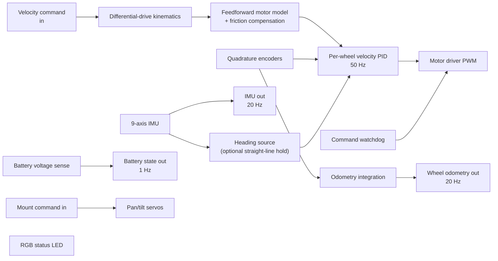

# 7. Motion firmware

[← Back to index](../README.md) · [← 6. Robot platform](06-platform.md)

[`scout_loco`](https://github.com/Xmindz/scout_loco) is the firmware on Scout's
ESP32-S3. It is the only part of the robot with hard timing requirements: encoder
interrupts, a 50 Hz velocity loop, servo pulses, and a failsafe that stops the
tracks when commands stop arriving. It is a **micro-ROS** participant in its own
right — it publishes and subscribes to the same interfaces as everything else on
the robot, over a single USB cable.

---

## 7.1 What the firmware is responsible for

| Area | Behaviour |
|---|---|
| **Drive control** | Differential-drive kinematics onto two tracks through a dual motor driver, with hardware PWM channels per direction pin. |
| **Closed-loop velocity** | A PID per wheel at 50 Hz on encoder-derived speed, on top of a feedforward motor model — so the loop trims a residual rather than discovering the plant from scratch. |
| **Friction compensation** | Explicit per-side static/Coulomb terms, because the two tracks break loose at different duty. Leaving that to the integral term was measurably too slow, and the resulting heading error was never recovered afterwards. |
| **Odometry** | Tick-integrated pose published at 20 Hz as a **message only** — the firmware deliberately broadcasts no transform, so the host's fusion filter owns that edge alone. |
| **Inertial sensing** | A 9-axis fusion IMU read over I²C and published at 20 Hz, with the driver chosen specifically because it can *read back* and persist the fusion's learned gyro bias and use an external crystal. |
| **Heading** | An optional straight-line heading hold, fed by the IMU's yaw when available and falling back to integrated odometry when it is not. |
| **Power** | Battery voltage sensed through an oversampled, filtered analogue input, converted to state of charge through a measured lookup and published as a standard battery message at 1 Hz. |
| **Camera mount** | Two hobby servos driven from the mount command topic, clamped, on a PWM peripheral that cannot collide with the motor channels. |
| **Safety** | A command watchdog that stops the tracks if no velocity command arrives within 1.5 s, independent of anything upstream. |
| **Connectivity** | An agent connection state machine: wait, connect, health-check periodically, and on loss return to waiting with the motors stopped and entities torn down cleanly. |
| **Time** | Clock synchronisation with the host, so message timestamps are real time rather than milliseconds since boot. |
| **Diagnostics** | A selectable telemetry stream carrying control-loop internals, and a single RGB status LED whose hue answers "is it alive, is it talking, is anything broken". |

---

## 7.2 Calibration is measured, not derived

The most distinctive property of this firmware is that its constants are the
result of experiments on the physical robot, each recorded with the measurement
that produced it.

- **The motor model was fitted against *achieved* velocity**, not commanded, so the
  fit stays valid where the loop had not fully converged. The two sides' gain
  slopes agreed within 2.4%, which localised the entire left/right asymmetry into
  the friction intercepts — about 21 counts of extra friction on the stiffer
  track. "That is the number the robot was quietly steering itself with."
- **The feedforward slope was measured rather than derived** from maximum duty and
  maximum speed. The derived form forced the model through full duty at full
  speed, which this drivetrain does not obey — over-driving by roughly 9% at every
  speed and making the PID spend its authority correcting the model instead of the
  wheel mismatch. A headroom check confirms neither wheel saturates at full
  command.
- **Per-side track scale cannot be measured from telemetry at all.** The encoders
  sit on the motor shafts, so they measure sprocket rotation rather than ground
  travel; a difference in track tension changes the effective rolling radius. A
  robot curving steadily reports itself as driving perfectly straight, and a
  heading hold then faithfully holds a heading that is not real. So the trim was
  calibrated from the physical path — drive a straight line against a reference and
  measure the lateral deviation — and the ideal kinematic derivation was found to
  predict the sensitivity about four times too small, because skid-steer tracks do
  not obey it.
- **Covariances are treated as consumed data, not decoration.** A fusion filter
  weights each input by them, so a wrong value is a silent estimator bias; the
  published values come from measurements.
- **Diagnostic telemetry has modes**, one per bring-up step — control loop, heading,
  encoder phase, raw tick calibration, IMU — because a single fixed payload cannot
  serve both a 1 Hz "is it alive" glance and a 10 Hz measurement run.

---

## 7.3 Hardware lessons recorded in the firmware

This firmware doubles as the robot's electrical documentation, and several entries
are the kind of thing that costs a day to rediscover.

- **A floating input pin manufactures odometry.** With encoder readout enabled on
  unconnected pins, the robot reported itself wandering at up to 2.3 rad/s while
  sitting still on the bench: unconnected inputs pick up enough noise to fire the
  edge interrupt, and every phantom edge is integrated into the pose as real
  travel. The pins now come up pulled high so that enabling readout before the
  encoders are wired fails loudly — a pinned input reports zero motion — rather
  than silently inventing movement.
- **Pins that look free are not.** The in-module flash and octal PSRAM consume
  whole GPIO ranges, including a range that is broken out on the development
  board's header and is therefore the easiest mistake to make. The pin map names
  every consumed pin and why.
- **5 V encoder signals need level shifting**, and internal pull-ups are not a
  substitute — they pull to 3.3 V, while the damage case is the encoder driving
  5 V into the pin.
- **Native USB removed a whole class of problem.** The microcontroller's built-in
  USB serial peripheral is a fixed-function device in silicon: it costs no CPU,
  survives the application crashing, and carries download mode, so one cable
  flashes, monitors and runs micro-ROS. Because it is not a UART, no line rate is
  negotiated — which retired an earlier baud-rate mismatch that presented as the
  link working in one direction only.
- **Every stray byte on that link is a byte inside the transport's framing**, so
  the firmware logs nothing to the serial port and pins its log level off.
- **Clock synchronisation is refreshed only while stopped.** The call blocks, and a
  stall of that length inside the control loop *is* a stall in the control loop. It
  costs nothing to wait: the module's crystal drifts about 12 ms over ten minutes
  of continuous driving.
- **Message memory is pre-sized.** The micro-ROS build uses static memory, so the
  deserialiser will not grow a variable-length field itself — it fails the take,
  which the executor then drops with no callback and no error. Every nested string
  and sequence on a subscribed message is pre-allocated up front, and publish-only
  messages are documented as not needing it.
- **A status LED with hue beats a status LED with blink counts.** One colour
  answers alive/talking/broken at a glance; the only surviving blink count is the
  one case that genuinely has a number in it — which initialisation step failed.

---

## 7.4 Interfaces

| Direction | Interface | Notes |
|---|---|---|
| In | Velocity command | Clamped to the measured maximum; watchdog-timed |
| In | Camera-mount angles | Firmware angle convention, clamped; see [Architecture §1.7](01-architecture.md#17-coordinate-honesty-three-angle-systems) |
| Out | Wheel odometry | 20 Hz, message only, no transform |
| Out | IMU | 20 Hz, with measured covariances |
| Out | Battery state | 1 Hz, decoupled from the control and odometry loops |
| Out | Control-loop telemetry | Selectable content, diagnostics only |
| Out | Log messages | Relayed into the robot's normal log stream |

Nominal figures: a 20 cm effective track separation, 45 mm drive wheels, and a
maximum linear speed of about 0.52 m/s as commanded (measured slightly higher at
full duty). Those numbers are what the navigation layer's tuning assumes — see
[Navigation §5.8](05-navigation.md#58-tuning-a-tracked-base-what-the-robot-taught).

---

## 7.5 Build and toolchain

Built with **PlatformIO** on the Arduino framework, with micro-ROS compiled from
source for the target ROS distribution on the first build. The board's real memory
configuration is declared explicitly rather than inherited from the stock board
definition, because the stock definition describes a different variant and would
produce a bootloader built for the wrong memory layout.

Two operational notes matter across repository boundaries:

- The serial port is normally held continuously by the host's micro-ROS agent
  service, so it has to be stood down before flashing.
- The agent and the firmware's pinned client library must stay in step; a mismatch
  presents as the board looping on client creation while the handshake never
  completes.

---

| ← Previous | Next → |
|---|---|
| [6. Robot platform](06-platform.md) | [8. Hardware](08-hardware.md) |
