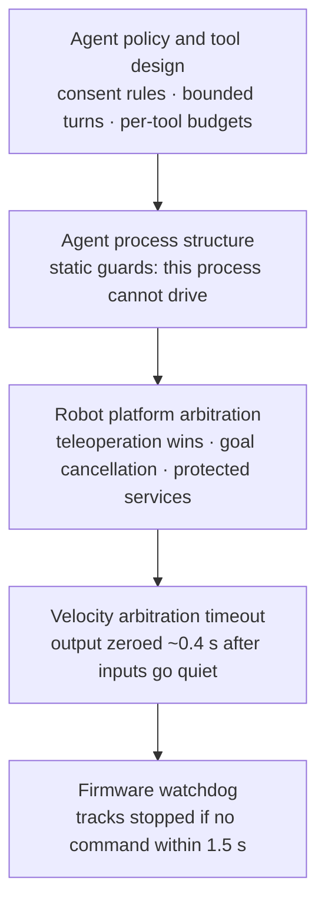

# 9. Safety, reliability and limits

[← Back to index](../README.md) · [← 8. Hardware](08-hardware.md)

A language model with wheels is a safety problem before it is a product. This
page collects Scout's safety model in one place, and then states — plainly and
without hedging — what Scout cannot do. Both halves are design output. A robot
that hides its limits sends its operator after the wrong problem.

---

## 9.1 Layered safety

No single component is trusted to keep the robot safe. Each layer below holds
even if the layer above it has crashed, hung, or gone mad.

| Layer | Guarantee |
|---|---|
| **Firmware watchdog** | The tracks stop if no velocity command arrives within 1.5 s. Independent of the host entirely — a crashed or wedged Pi stops the robot. |
| **Velocity arbitration timeout** | Output is zeroed roughly 0.4 s after every input goes quiet: a closed tab, a locked phone, a dropped network. No input can leave a stale command running. |
| **Teleoperation priority** | Grabbing the on-screen controls overrides an autonomous goal on the next tick, and the goal is then cancelled so it does not resume when you let go. |
| **One publisher per velocity topic** | Structurally enforced and documented; two publishers interleaving presents as stuttering rather than as a configuration error. |
| **Protected services** | The agent may not stop the serial bridge to the microcontroller (its port reset drops motor state mid-motion) or the bridge stack it is talking over. |
| **Structural inability to drive** | The agent process cannot publish velocity for tracking or following — enforced by tests that inspect the modules' syntax trees, not by convention. |
| **Obstacle-aware relative motion** | "Move forward one metre" runs as a navigation behaviour on the local costmap, so it stops short of obstacles rather than driving into them. |
| **Bounded motion requests** | Relative moves are bounded in distance and angle, with over-range requests answered in words. |
| **Per-tool budgets and bounded turns** | A confused turn cannot drive a real machine around the house indefinitely, and ends with a spoken sentence rather than a framework error. |
| **Refusals with reasons** | No goal when the robot does not know where it is; no goal on a map that is drawable but not navigable; no camera aim at an arbitrary target it cannot resolve. |
| **Stop is never gated** | Stopping motion or stopping a follow takes no arguments, works from every state including "nothing is running", and is never held behind a confirmation. |

Two further principles apply to how the robot **reports**:

- **Consent over helpfulness.** Camera tracking of people is opt-in, off at boot,
  and started only because somebody asked — enforced on the robot, in the agent's
  policy, in each tool's description, and by a test that runs a real model against
  tempting prompts. See [The agent §2.8](02-ai-agent.md#28-policy-the-model-does-not-get-to-reinterpret).
- **Failures are named, not smoothed.** Lost is not blind. Returning is not idle.
  A saved map is not a live one. Stale health is not healthy. Accepted is not done.
  Each distinction exists because collapsing it sent somebody after the wrong
  problem at least once.

---

## 9.2 Operating the robot for the first time

Scout's own documentation includes a staged first-run procedure, ordered by blast
radius, and it is worth summarising here as a statement of how the project treats
physical risk:

1. **Read-only first** — health, room list, current room, what it sees. No motors.
2. **Test the brake before you need it** — send "stop" with the robot idle and
   confirm it reports the cancellation.
3. **Camera-only features before anything drives** — confirm the base does not move
   during camera tracking, and that a detection alone does not start it.
4. **One short leg with a hand near the robot**, watching for live progress, an
   actual stop on arrival, and a working mid-drive stop.
5. **The failure paths deliberately** — a room that does not exist, an ambiguous
   room name. Both should produce words and no motion.
6. **Subsystem-not-running paths**, including the case that discards an unsaved map,
   which the robot announces.
7. **A multi-leg trip last**, checking that a mid-trip failure stops the trip.

---

## 9.3 Known limits

### Motion and physical reach

- Top speed roughly **0.55 m/s** — it cannot keep up with a walking adult.
- The follower **does not plan a route**: no map, no costmap, no memory, so it sits
  down in local minima (a U of furniture, a doorway not squarely approached) and
  reports being blocked rather than solving them.
- The laser scanner sees **one slice about 20 cm off the floor** — blind to glass,
  table tops, anything lower, and to **drops, steps and stairs**, which no sensor
  on the robot can see.
- In-place rotation needs enough speed to break track stiction; below that the
  robot buzzes without turning. Handled in the controller configuration, but it is
  a property of the chassis.
- A returned "come back" lands within navigation tolerance (about 0.12 m), not
  exactly on the spot.

### Camera and tracking

- Pan reaches roughly **±50°** — it cannot look behind without turning the body.
- Tilt is strongly asymmetric: far up, only slightly down.
- Servo position is **modelled, not measured**; the modelled state lags during
  travel.
- A person much beyond **~8 m** cannot be locked onto.
- Roughly **0.6 s of loop dead time** means the camera trails a fast mover and can
  still limit-cycle on a still subject — reduced about threefold by measured
  tuning, but not eliminated. The suspected cause and the measurement that would
  settle it are recorded.
- The look-at-the-speaker hold has **no lock**: a second person crossing closer can
  take the aim. Tracking is the feature with a real lock behind it.
- The tracker **never stops itself** — it stays searching indefinitely, and says so.

### Voice

- **A spoken "stop" queues behind a running mission.** Turns are serialised and a
  navigation goal blocks for minutes; pre-empting a running turn needs a
  cancellation path that does not exist yet. Chat has the same limit; the on-screen
  and physical overrides do not.
- **On-device transcription is materially less accurate** than the hosted option
  (16.7% versus 4.5% word error rate), and its failures change meaning rather than
  wording.
- **Mission progress is not spoken**, only the final reply; a two-minute drive is
  silent until it finishes.
- **One-word answers sit close to the minimum clip length.**
- **The trailing-silence requirement cannot be tuned away** without clipping final
  words.
- **The acoustic path cannot be self-tested** by playing audio through the robot,
  because the robot cannot hear itself — the same property that makes barge-in
  safe.
- Small speech models are weak on proper nouns, so nothing downstream may rely on
  exact matching of rare words.

### Perception

- Detection covers a **fixed class list**; open-ended questions are answered by a
  vision model looking at a photograph instead.
- Inference is capped below the camera's frame rate to leave headroom for the live
  view's encode.
- Driving on-device speech recognition hard **costs detection frames**, because both
  share one accelerator.
- A failed detection poll makes the topic **go quiet** rather than publish an empty
  list, so "not arriving" stays distinguishable from "nothing detected" — the
  Services page surfaces this as a partial state.

### Agent

- A turn is bounded at 24 think-act rounds and by per-tool budgets; a genuinely
  large request can hit those ceilings and will say so.
- Photographs are shown to the model for the current turn only, capped at eight per
  model call.
- Remembered spots are session-scoped and map-scoped; naming a place permanently is
  a separate, explicit action.
- Answer quality depends on the configured model's tool-calling and vision ability;
  Scout is provider-agnostic, not provider-indifferent.

### Security and operations

- **No network-facing endpoint has authentication.** Anyone who can reach the robot
  can drive it and start or stop its services. The privileged service path is
  bounded by an exact-string allowlist, so the worst it grants is disruption of
  known units — but that is a bound on one path, not a security model. Scout
  assumes a trusted home network.
- The observability bridge, when running, permits publishing from any client on the
  network by default.
- Mapping and navigating cannot run at once; switching to navigation discards an
  unsaved map, which the robot announces rather than doing silently.

---

## 9.4 Open work

Recorded because a roadmap is more honest than a feature list:

- **Pre-empting a running turn**, so a spoken "stop" does not queue behind a
  mission.
- **Speaking mission progress**, not only the final reply.
- **Streaming the model's own tokens into speech synthesis** sentence by sentence,
  cutting the remaining wait before the robot starts talking.
- **Settling the camera tracking limit cycle**, via the flagged mount-calibration
  assumption and the measurement that would confirm it.
- **Vendor-side endpointing on the hosted speech path**, the only route to cutting
  into the trailing-silence hangover — available only because the hosted path lifts
  the no-streaming rule.

---

| ← Previous | Next → |
|---|---|
| [8. Hardware](08-hardware.md) | [10. Technology stack and glossary](10-technology.md) |
